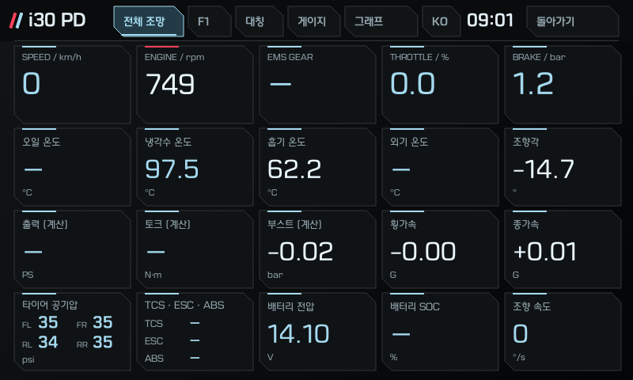

# i30 PD Dashboard

현대 i30 PD 순정 내비(D-Audio Plus)에 올리는 실시간 차량 정보 대시보드입니다. 벨로스터 N용 [reikop/veloster-n-dashboard](https://github.com/reikop/veloster-n-dashboard)를 i30 PD(1.6 T-GDI)에 맞게 포팅했습니다. 이 레포는 원작의 포크라 앱 소스가 그대로 들어 있습니다.

차량 값은 내비가 원래 받고 있는 데이터를 읽기만 합니다. 차에 아무것도 보내지 않습니다.

> **현대자동차 공식 앱이 아닙니다.** 순정 시스템에 앱을 설치하는 작업이라 보증·AS에서 불이익이 있을 수 있고, 책임은 사용자에게 있습니다. 주행 중에는 화면을 조작하지 마세요. 지금까지 차 1대에서만 확인했습니다.

## 표시되는 값

| 분류 | 값 |
|---|---|
| 엔진 | RPM, 부스트(bar), 부하율, 스로틀 개도, 가속 페달, 점화 시기, 냉각수·흡기 온도, 보정·마찰 토크 |
| 변속 | P/R/N/D, D에서 현재 단수, 수동 모드 M1~M7. 6단 수동차는 RPM ÷ 속도로 계산한 단수(클러치를 밟는 동안 유지, 중립은 N, 후진은 R)와 계기판 변속 권장(`▲4`, 화살표는 실차 미확인) |
| 주행 | 속도, 횡G·종G(G볼), 요레이트, 조향각·조향 속도·조향 토크 |
| 제동 | 브레이크 압력, 브레이크 스위치, 전자식 주차 브레이크 |
| 연비 | 순간 연료소모(L/h), 트립 평균 연비(km/L), 주행가능거리 |
| 차체 | 운전석·조수석 문, 트렁크, 후드(열림/닫힘), 와이퍼, 좌우 방향지시등 |
| 기타 | 타이어 공기압 4개, 배터리 전압, 주행 모드(ECO/NORMAL/SPORT), 주행거리 |

- **유온**: 이 엔진(감마 1.6 T-GDI)에는 엔진오일 온도 센서가 없습니다. F1·퍼포먼스 탭은 그 자리에 흡기 온도를 보여 주고, 게이지·그래프 목록의 유온 항목은 실린더 헤드 냉각수 센서 값을 "대체"라고 표시해 보여 줍니다.
- **없는 값**: 실제 오일·미션오일 온도, 바퀴별 휠속, TCS/ESC 개입 표시, 뒷문 2개, 안전벨트는 내비로 들어오는 데이터에 없습니다.

탭별 기능과 화면은 [`i30pd_port/app/TABS.md`](i30pd_port/app/TABS.md)에 있습니다. 헤더 버튼으로 화면 테마 8가지(기본 N, 람보, BMW, 그리고 완전 검정 배경의 아이스·모노·앰버·틸·나이트)를 고를 수 있고, 클러스터 탭에는 계기판식 화면 3가지(클래식·레트로·랠리)가 있습니다.

## 설치

차주용 순서는 [`INSTALL.md`](INSTALL.md)를 보세요. [Releases](https://github.com/sung9155/i30-pd-dashboard/releases)의 `i30pd-installer.zip`(Windows) 또는 `i30pd-installer-mac.zip`(맥)과 USB 케이블이면 됩니다. 차 화면에서 엔지니어 모드와 Factory Test를 한 뒤 압축을 풀고 `설치.cmd`(맥은 `설치.command`)를 더블클릭하면 APK 내려받기, 연결 확인, 설치를 대신 해 줍니다. ADB 명령으로 직접 설치하는 방법도 같은 문서에 있습니다.

**적용 조건:** 순정 D-Audio Plus(`pd_kr`). 1.6 T-GDI 7단 DCT와 6단 수동(N Line)에서 확인했고, 1.6 디젤은 화면 눈금을 자동으로 맞추지만 실차 미확인입니다. 내비 소프트웨어 빌드 `eng.vmadmin.20260114.084130`(블루링크)과 `eng.vmadmin.20260114.084725`(블루링크 없음)에서 확인했습니다. 다른 빌드에서도 동작하지만 데이터 배치가 다르면 값이 틀릴 수 있으니, 결과를 [Issues](https://github.com/sung9155/i30-pd-dashboard/issues)에 알려 주세요.

## 직접 빌드

이 레포를 받아 바로 빌드·서명합니다. 원작 대비 바뀐 내용 전체는 `git diff 2be141b`로 볼 수 있습니다. 절차는 [`i30pd_port/app/README.md`](i30pd_port/app/README.md)의 "빌드"와 "내 앱" 절에, 도구 설치는 [`i30pd_port/SETUP_laptop.md`](i30pd_port/SETUP_laptop.md)에 있습니다.

브랜치: `main` = 안정화(Releases의 Latest), `test` = 테스트 빌드(실차 검증 전, `test` 사전 배포). v1.6.9 이전 릴리스와 패치 파일 시절 기록은 [i30-pd-dashboard-legacy](https://github.com/sung9155/i30-pd-dashboard-legacy/releases)에 있습니다.

## 레포 구성

| 경로 | 내용 |
|---|---|
| `apps/` · `shared/` · `tests/` · `scripts/` · `translations/` | 앱 소스와 빌드·시험 도구 (원작 구조 그대로, i30 PD 포팅 적용) |
| `apks/` · `menu-entry/` · `README_veloster*.md` · `NOTICE_veloster.md` | 원작(벨로스터 N) 그대로. **`apks/`의 APK는 벨로스터 N용이라 i30 PD에 설치하지 마세요** |
| `INSTALL.md` | 차주용 설치 안내 |
| `i30pd_port/app/` | 포팅 설명, 탭 설명, 화면 이미지, PC에서 화면을 그리는 미리보기 도구 |
| `i30pd_port/HSCAN_DECODE.md` | 내비가 받는 차량 데이터(hscan 슬롯)를 CAN 메시지·신호로 해석한 기록과 근거 |
| `i30pd_port/tools/` | 슬롯 해석 도구 (DBC 대조, 캡처 비교, 비트 지문) |
| `i30pd_port/logs/` | 실차 캡처 로그 (정차 상황별, 10분 주행) |
| `i30pd_port/installer/` | 설치 · 삭제 스크립트(Windows `설치.cmd` · `삭제.cmd` + `install.ps1`, 맥 `설치.command` · `삭제.command`) |
| `i30pd_port/cluster/` | 예전 대칭 탭(클러스터 화면) 소스, 보관용(앱에서는 삭제) |
| `i30pd_port/car_session.sh` 등 | ADB로 실차 데이터를 덤프·태깅하는 스크립트 |

## 라이선스

MIT. 원작의 저작권 표시를 함께 담았습니다. 출처, 상표, 이 레포에 넣지 않은 것은 [`NOTICE.md`](NOTICE.md)를 보세요.

---

## English

A live vehicle-data dashboard for the Hyundai i30 PD factory head unit (D-Audio Plus), ported from [reikop/veloster-n-dashboard](https://github.com/reikop/veloster-n-dashboard); this repository is a fork of it with the port as commits on top. It only reads the data the head unit already receives and never writes to the car. Not an official Hyundai app; install at your own risk. Install steps (Korean): [`INSTALL.md`](INSTALL.md). Signal decoding notes: [`i30pd_port/HSCAN_DECODE.md`](i30pd_port/HSCAN_DECODE.md). License: MIT, see [`NOTICE.md`](NOTICE.md).
