# 대시보드 앱 탭별 기능 (i30 PD 빌드)

이미지는 **실제 앱 렌더러 코드**(이 레포의 소스)에 **실차 주행 로그**(`logs/act_one_drive_10min_20261029_183922.log` 끝 지점, 42 km/h·4단)를 앱 자체 디코더 `Telemetry.hscanPd()`로 흘려 그린 것이다. 가짜 값 없음. 미리보기는 영어(EN) 화면으로 그렸다.

예전의 **대칭** 탭(esp32CarInfo 배치, `cluster/`)은 10/30에 앱에서 삭제했다. 같은 정보는 레이스 탭이 더 많이 보여 준다.

다시 그리기: `bash i30pd_port/app/preview/preview.sh <이 레포 루트> [로그] [출력 폴더] [로그 위치 0~1]` → `app/screens/*.png` (JDK만 필요, `android.graphics`는 Java2D 대역).

글꼴: 차량과 같은 Android 4.2 Roboto를 `preview/fonts/`(git 미포함, Apache 2.0)에 두면 영문·숫자를 Roboto로, 한글은 맑은 고딕으로 그린다(차량도 한글은 대체 글꼴). 없으면 전부 맑은 고딕. 받기:
```
for f in Roboto-Regular Roboto-Bold; do curl -sfL "https://android.googlesource.com/platform/frameworks/base/+/refs/heads/jb-mr1-release/data/fonts/$f.ttf?format=TEXT" | base64 -d > i30pd_port/app/preview/fonts/$f.ttf; done
```

## 공통 — 상단 내비 (52 px)

**화면 탭**(사용하는 화면마다 하나, 넘치면 옆으로 넘김), 시계 왼쪽 **톱니바퀴**(설정: 화면 사용 여부·테마·차량 색·주행 모드·RPM·사운드·언어·고장코드 조회), 시계, `돌아가기`(앱 종료). 화면 23개(전체 조망·게이지·그래프·F1·퍼포먼스·레이스·기록·쇼·클러스터 레이아웃 15개)는 모두 이 탭 줄과 화면 목록에 있다(테스트 버전부터, 아래 "화면 목록"). 곡이 바뀌면 하단에 미디어 알림 카드가 5초 뜬다(그래프 제외, 그리고 곡 정보를 이미 보여 주는 화면 — 레이스 탭 음악 칸·F1 음악·택시 라디오·카세트 — 에서는 뜨지 않음). 차량 값이 없으면 지어내지 않고 "—".

대시보드를 열면 1.5초 동안 **환영 화면**이 지나간다: 어두운 덮개가 걷히고, 강조색 띠가 화면을 가로지르고, `// i30 PD` 배지가 떠올랐다가 실시간 화면으로 바뀐다(아래는 중간 지점).

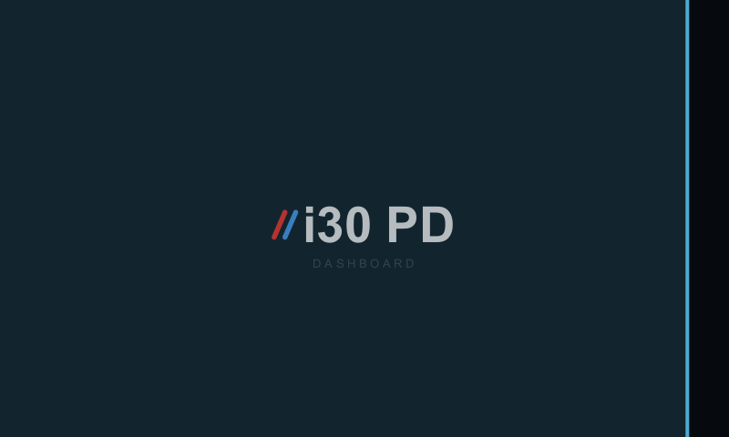

## 1. 전체 조망

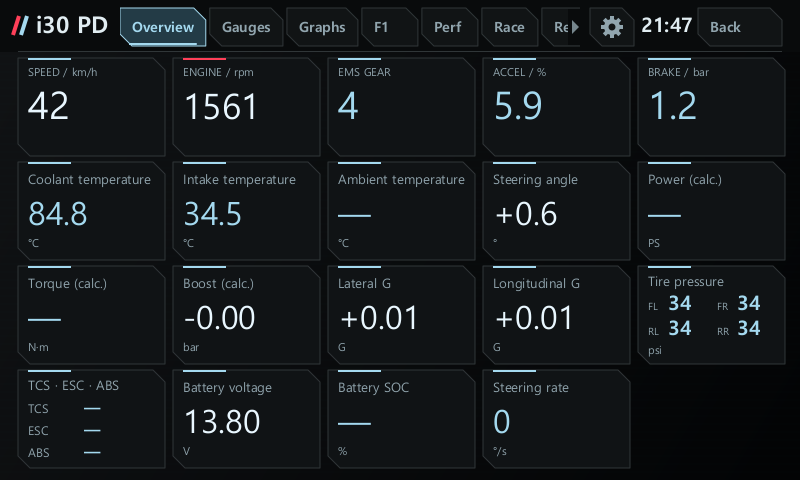

- 19칸 고정 배치. 첫 줄은 큰 헤드라인: **속도 · RPM · 현재 기어 · 가속 페달 · 브레이크압**.
- 나머지: 냉각수 · 흡기온 · 외기온 · 조향각 · 출력 / 토크 · 부스트 · 횡G · 종G · 타이어 공기압 4개 묶음 / TCS/ESC/ABS 묶음 · 배터리 전압 · SOC · 조향 속도. 오일온 센서가 없어 냉각수 값을 되풀이하던 유온 카드는 뺐다.
- 큰 숫자는 자리마다 같은 폭으로 그려서 `1`이 끼어도 숫자가 흔들리지 않는다(게이지·F1·레이스 탭도 같음).
- **카드를 탭하면 표시 모양이 순환**: 숫자 → 막대 → 원호 → 숫자. 값이 바뀌는 순간 숫자가 밝게 깜빡인다.

## 2. F1 (레이스 표시)

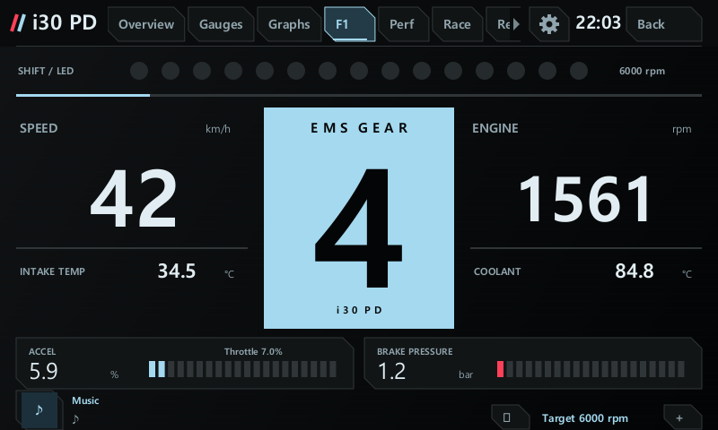

- **변속 LED 15개**(파랑 5 · 흰 5 · 빨강 5): 목표 RPM − 1500부터 100 rpm마다 하나씩 켜진다. 목표 이상 + 주행 중 + 1~5단이면 전체가 깜빡이며 `SHIFT ↑`.
- **목표 RPM은 하단 −/+로 3000~6700 조절**(디젤 2100~4700, 100 단위, 저장됨). 표시용 안내일 뿐 ECU 제어 아님.
- 가운데 큰 **현재 기어**, 좌 속도 · 우 RPM, 흡기온 · 냉각수, 스로틀 · 브레이크압 20칸 막대. 맨 위 가로선은 RPM 막대(0~8000).
- 좌하단 앨범 아이콘을 탭하면 → **F1 + 음악**:

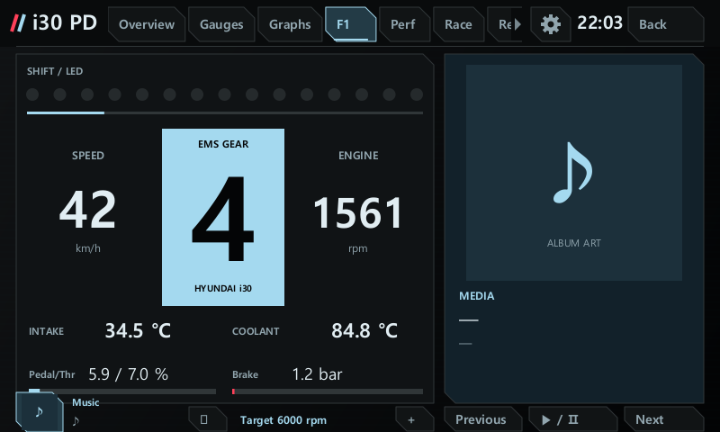

  왼쪽에 축소한 F1(LED·기어·속도·RPM·온도·페달), 오른쪽에 앨범 아트 · 곡 · 아티스트 · 진행 막대 · `이전 / 재생·일시정지 / 다음`.

## 3-1. 퍼포먼스 (N 차량 N 모드 '퍼포먼스' 화면 이식)

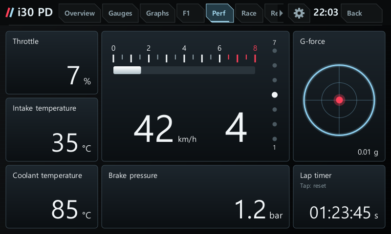

벨로스터 N·i30 N 순정 내비 N 모드의 퍼포먼스 화면 배치를 따랐다. 짙은 유리 카드(위가 밝은 그라데이션 + 얇은 테두리), 왼쪽 위 이름, 오른쪽 아래 큰 숫자와 작은 단위(글꼴은 전체 조망 탭과 같은 기본 글꼴).

- 왼쪽 3칸: **스로틀**(스로틀판 개도 TPS) · **흡기 온도** · **냉각수 온도**. N 화면의 오일 온도 자리에 흡기 온도를 넣었다(오일온 센서 없음).
- 가운데 큰 칸: **RPM 눈금**(0~8, 7000부터 빨강)과 흰 막대, 오른쪽 **단수 점 7개**(7DCT, 위가 7단), 아래 **속도 km/h**와 **변속 표시**(P/R/N, D에서는 단수, 수동 게이트에서는 `M3` 식).
- 가운데 아래 왼쪽: **브레이크 압력**(bar).
- 오른쪽 위: N 화면의 '서킷'(GPS 랩 지도) 자리. 이 앱은 GPS 트랙을 쓰지 않으므로 같은 모양(하늘색 원 + 빨간 점)의 **G-포스**(반경 1.2 g)를 넣었다.
- 아래 오른쪽 넓은 칸: **랩 타이머** `분:초.1/100초`(예: 1:23.45). 왼쪽에 지금 랩(크게)과 랩 번호, 오른쪽에 지난 랩 · 최고 랩 · 최고 대비(빠르면 초록, 느리면 빨강).
  - 탭: 시작 → 달리는 중에는 한 번 탭할 때마다 그 랩을 기록하고 다음 랩 시작. 랩 시작 3초 안의 탭은 무시(두 번 눌림 방지).
  - 길게(0.7초): 달리는 중이면 정지, 정지 상태면 전체 초기화. 정지 상태에서 탭하면 같은 랩을 이어서 잰다.
  - 앱을 닫으면 사라진다. 미리보기 이미지의 랩 값은 예시.

## 3-1b. 쇼

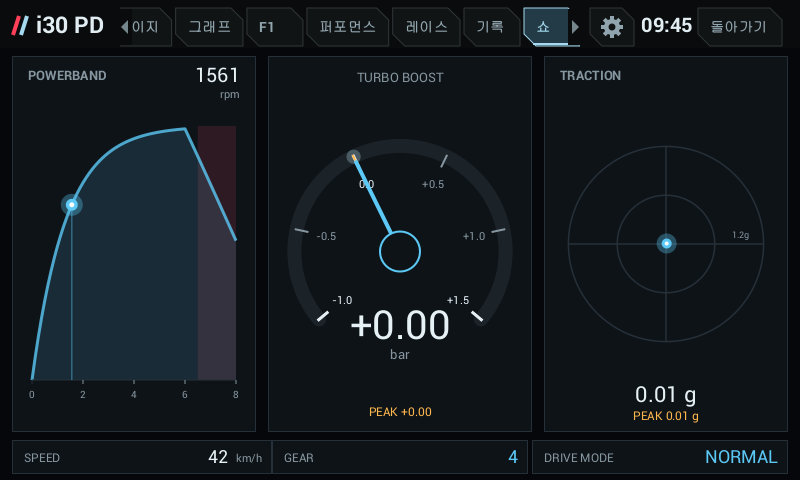

보는 재미를 위한 화면(화면 목록의 `쇼` 칸; 예전엔 퍼포먼스 탭을 한 번 더 눌렀다). 차가 이미 보내는 값만 쓴다.

- 왼쪽 **파워밴드**: 1.6 T-GDI 토크 곡선 모양(실측이 아닌 그림) 위를 현재 RPM 점이 따라 움직이고, 레드라인 구간을 표시한다.
- 가운데 **터보 부스트 게이지**(−1.0~+1.5 bar): 부드럽게 움직이는 바늘, 주황 최고값 바늘(`PEAK`), 부스트가 오를수록 커지는 빛.
- 오른쪽 **트랙션 서클**: 횡G·종G 점과 사라지는 잔상, 최고 g 표시.
- 아래 줄: 속도 · 기어 · 주행 모드. 강조 색이 주행 모드를 따른다(SPORT 빨강, ECO 초록, 그 외 하늘색).
- **가장자리 빛**: 세게 밟아 감속하면 빨강, 부스트가 오르면 파랑, 방향지시등을 켜면 그쪽 가장자리가 주황으로 깜빡인다. 아무 일도 없으면 꺼져 있다.

## 3-2. 레이스 (평면 레이싱 디스플레이)

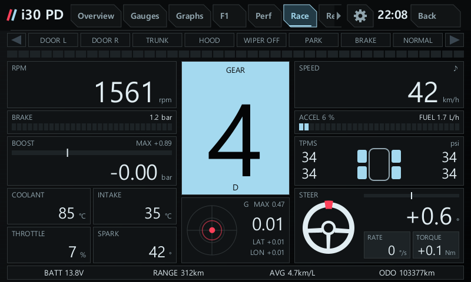

F1 탭처럼 평면 패널(직사각형, 1 px 테두리)과 F1 색으로, 애프터마켓 레이싱 디스플레이 배치를 따랐다. 한 화면에 최대한 많이.

레이스 탭과 기록 페이지는 한국어 설정에서도 글자를 영어로 쓴다.

**차종별 칸**(테스트 버전, 프리뷰 확인·실차 보류):
- **수동(6MT)**: 브레이크 막대 왼쪽에 **CLUTCH** 칸이 생긴다. 둘째 줄이 발밑 페달 순서(클러치 · 브레이크 · 기어 · 가속)와 같아진다. 클러치를 밟으면 칸이 강조색으로 차고 `IN`, 떼면 `OUT`, 값이 없으면 "—". 신호는 단수 계산에 쓰는 EMS12 `CLU_ACK`(byte3 bit7, 6MT 오너 실차 확인)를 받은 그대로 보여 준다. 같은 비트가 7DCT에선 P/N을 뜻하므로 자동변속기 화면에는 나오지 않는다.
- **7DCT 클러치 온도 (beta, 2026-11-04)**: 변속기(TCU)에 2초마다 `22 01A4`를 물어 **홀수단(1·3·5·7)**·**짝수단(2·4·6·R)** 클러치 온도를 받는다(OBDb Hyundai-i30 식: 16비트 ×2 − 40 °C, 우리 차 응답으로 위치·홀짝 확인 — `OBD_PROBE.md`). 응답이 오기 전에는 아무 화면도 바뀌지 않고, 6MT(TCU 없음)는 세 번 응답이 없으면 그만 묻는다. 150 °C부터 주황, 180 °C부터 빨강이고 빨강이면 칸을 채운다(기준은 추정, 순정 "변속기 온도 높음" 경고가 뜬 온도를 잡으면 고친다). 보이는 곳: 레이스 CLUTCH 칸(`ODD`/`EVEN`), 전체 조망 마지막 칸(DCT 클러치), F1 브레이크 칩, 퍼포먼스 브레이크 카드, HUD `CLU`(주황부터 깜빡임), 엔진 메시지 창, 드래그(측정하지 않을 때 속도 아래), 기록 6번째 칸 `MAX CLUTCH`(세션 최고), 야간·8비트는 주황 이상일 때만 경고. 게이지·그래프에서도 고를 수 있다.
- **디젤**: 점화시기가 없는 SPARK 칸 자리가 **DPF** 칸이 된다. 엔진 ECU에 표준 OBD PID를 묻는다(읽기만): `0x8B` 재생 상태·**재생 트리거**(다음 재생까지 얼마나 찼는지, %), `0x7A` DPF 차압(kPa), `0x7C` DPF 온도(°C). 칸에는 세 값을 함께 보인다: 오른쪽 아래에 재생 트리거 %를 크게, 왼쪽에 `ΔP`(차압, kPa)와 DPF 온도 °C를 작게. 오른쪽 위에는 포집 거리 — `LAST` = 앱이 본 마지막 재생이 끝난 뒤 달린 km(재생 상태 1→0일 때의 주행거리를 기억, 앱을 다시 켜도 유지, 첫 재생 전에는 없음)와 `AVG` = ECU가 주는 재생 사이 평균 km(`0x8B`) — 를 3초씩 번갈아(하나만 있으면 그것만, 재생 중에는 숨김). 둘 다 게이지·그래프에서도 고를 수 있다(`DPF 재생 후 거리`·`DPF 평균 재생 간격`). 재생 중이면 제목이 `DPF REGEN`, 숫자가 모두 주황이 된다. 답이 없는 값은 "—"(회색).
- **다른 화면의 클러치·DPF**: 6MT면 F1 브레이크 칸 위와 퍼포먼스 브레이크 카드에 `CLUTCH IN/OUT`(밟으면 하늘색). 디젤이면 엔진 계기판의 `SPK` 줄이 `DPF`(재생 트리거 %, 재생 중 주황)로 바뀌고 메시지 창에 `DPF REGEN`, 야간 미니멀 아래 칸에 "DPF 재생 중", 클래식·랠리 경고등 줄에 `DPF` 등(재생 중 주황). 7DCT 가솔린 화면은 그대로(프리뷰 `x_f1_mt_clutch`·`x_perf_mt_clutch`·`x_*_diesel_regen`). 세 값은 게이지·그래프에서도 고를 수 있다(`DPF 차압`·`DPF 온도`·`DPF 재생`·`DPF 재생 트리거`). 각 PID는 응답 첫 바이트(지원 표시)가 가리키는 값만 쓰고, 세 번 연달아 답이 없으면(가솔린) 그 주행 동안 다시 묻지 않는다. 응답 원본은 10초에 한 번 기록(`VehicleDash` 태그)에 남아 진단 기록으로 받아 볼 수 있다. PD 디젤 차주의 화면은 이 표준 PID에 답이 없어 "—"였다(2026-11-04). 그래서 현대 디젤 전용 요청 `22 ED03`(OBDb Hyundai-i30 정의, CC BY-SA 4.0)도 함께 묻는다: 데이터 [36] DPF 차압 ×4.31373 hPa(→ kPa), [38] DPF 앞 배기 온도 ×4.7098 + 99 °C, [45..48] 마지막 재생 후 거리(m, ECU가 세는 값이라 우리 주행거리 계산보다 우선). 재생 트리거가 없으면 레이스 DPF 칸은 차압을 크게(`DPF ΔP … kPa`), 엔진 화면 DPF 줄도 차압을 보여 준다(프리뷰 `4c_race_diesel_ed03`). 휘발유 엔진은 `7F 31`로 답해 세 번 뒤 그만 묻는다. 원본은 10초에 한 번 `OBD ED03:`로 기록에 남는다. 재생 중 여부는 이 응답에 없어 주황 `DPF REGEN`은 아직 나오지 않는다. 실제 PD 디젤의 응답은 아직 확인 전이다. 포집량은 v1.8.6부터 `22 ED1D`(OBDb의 기아 씨드 CD 2018 검증 정의: 데이터 [4..5] u16 ×256/65535, g로 읽음)를 2초마다 묻고, 답이 오면 레이스 DPF 칸·엔진 DPF 줄·묶음 칸의 큰 숫자가 포집량 g(`DPF SOOT`)가 된다(우선순위 포집량 → 재생 트리거 % → 차압 kPa, 프리뷰 `4c_race_diesel_soot`). 게이지·그래프에서 `DPF 포집량`도 고를 수 있다. 색 단계는 실제 재생이 시작되는 포집량을 본 뒤에 정한다. 진단 요청 시험에 `22 ED06`(재생 완료 상태)도 넣었다. **차 신호(hscan)로도 읽는다(2026-11-05):** 디젤 EMS19 자리 `0x0e`의 b5 = 재생 중(차주가 재생을 느낀 주행에서 1, 그동안 공회전 연료 2배), b4 = 포집량 g(재생 중 21→11로 줄어듦, 1 g/칸 추정). OBD에 답이 없어도 `DPF REGEN`(주황)·`DPF SOOT`·재생 후 거리가 나온다. `22 ED1D`가 답하면 포집량은 그 값을 쓴다.

| 6MT · 클러치 밟음 | 6MT · 클러치 뗌 | 디젤 |
|---|---|---|
| 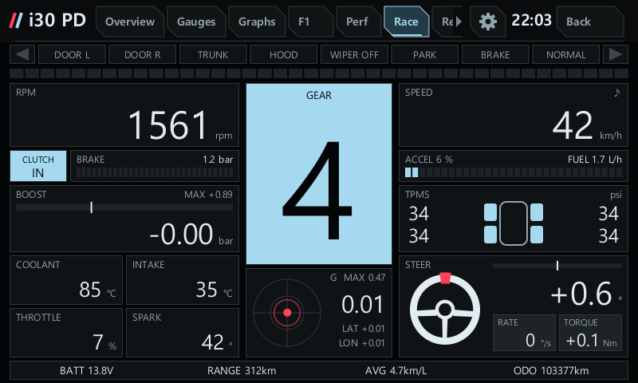 |  |  |

- 맨 위 **상태 줄**: `DOOR L` · `DOOR R` · `TRUNK` · `HOOD`(열리면 빨강) · `WIPER OFF/LOW/HIGH`(작동 시 하늘색) · `PARK`(EPB 체결 시 빨강) · `BRAKE`(스위치 ON 시 주황) · 주행 모드(SPORT 빨강, ECO 초록). 값이 없으면 어두운 글씨. 줄 양 끝의 **방향지시등 화살표**는 깜빡이를 켜면 램프와 함께 주황으로 깜빡인다(CGW1 `TurnSigLh/Rh`, 꺼져 있으면 회색).
- 그 아래 **변속 등**: F1 탭의 변속 목표(기본 6000 rpm, F1 탭 `− / +` 또는 설정 `RPM`으로 3000~6700, 디젤 기본 4200·2100~4700, 어느 쪽이든 레드라인을 넘지 않음)를 쓴다. 목표의 마지막 1/4 구간(6000이면 1500 rpm 앞)부터 양 끝에서 가운데로 초록 → 주황 → 빨강이 차오르고, 목표에 닿으면 막대 전체가 하늘색으로 깜빡인다(0.1초 간격).
- **변속 연출**: 목표 300 rpm 앞부터 기어 칸에 빨간 테두리가 두꺼워지고, 목표에 닿으면 기어 칸이 빨강/하늘색으로 깜빡이며 `SHIFT ▲`, 화면 가장자리도 빨간 테두리로 함께 깜빡인다. 단수가 바뀐 직후(올릴 때·내릴 때 모두) 0.15초 동안 기어 칸이 하얗게 번쩍였다 돌아오고 숫자가 살짝 커졌다 줄어든다. 이 탭은 깜빡임을 위해 초당 20번 다시 그린다. 변속 신호는 1~6단에서만(7DCT 7단은 최고단).
- 왼쪽: **RPM**(6500 이상 빨강) · 그 아래 별도 칸 **브레이크 압력 막대**(6MT는 막대 왼쪽에 CLUTCH 칸이 붙음. 막대는 빨강, 0~100 bar, F1 탭과 같은 눈금, 오른쪽에서 왼쪽으로 차오름 — 가운데 기어 칸을 사이에 두고 악셀 막대와 대칭) · **부스트**(−0.8~+1.5 bar 막대, 화면을 연 뒤의 최고값 `MAX`) · 작은 칸 4개 **COOLANT · INTAKE · THROTTLE · SPARK**(냉각수 · 흡기온 · 스로틀 · 점화시기, 디젤은 SPARK 대신 DPF. 냉각수 100/110°C, 흡기 60/80°C 경고 색).
- 가운데: **기어**(하늘색 칸, P/R/N, D에서는 단수, 수동 게이트에서는 `M3`, 아래에 변속 레버 위치) · **G**(합성 g 값, 횡 LAT · 종 LON, 작은 G-볼).
- 오른쪽: **속도** · 그 아래 별도 칸 **가속 페달 막대**(하늘색, 0~100 %, 같은 칸 오른쪽에 글자로 **순간 연료소모 L/h**) · **TPMS 그리드**(왼쪽 부스트 칸과 같은 높이, 차체 윤곽 주위 네 바퀴, 30 psi 미만 주황, 26 psi 미만 빨강. 레이싱 디스플레이의 타이어 온도는 이 차 데이터에 없어 넣지 않았다) · **조향 칸**(왼쪽 작은 칸 4개와 같은 높이라 좌우 칸 경계가 맞는다. 조향각만큼 도는 단색 핸들 아이콘(N 핸들 배치: 조금 아래로 붙은 좌우 스포크와 아래 스포크 하나)과 큰 12시 방향 빨간 표시, ±540° 가운데 0 막대(반 바퀴를 넘으면 그림만으로는 방향을 알기 어려워서), 조향각, 그 아래 작은 칸 두 개에 조향 속도 °/s와 운전자 조향 토크 Nm).
- 맨 아래 **주행 줄**: 배터리 전압(12 V 미만 주황) · 주행가능거리 · 평균 연비 · 적산거리. 가속 측정이 진행 중이면 그 자리에 `0→100 km/h 3.4 s 측정 중`(주황), 끝나면 8초 동안 결과와 BEST(신기록이면 초록 ★)를 띄운다.
- **G**: 최근 약 2초의 궤적(옅은 하늘색 점)과 시동 후 최고 합성 G 경계선(빨간 원), `MAX` 값.
- **기어 칸 아래 안내**: 냉각수 70 °C 미만이면 `WARM-UP`, 정차하기 전 5분 안에 부스트 0.7 bar 이상 또는 4500 rpm 이상을 **합쳐서 30초 이상** 썼으면 `COOL-DOWN 0:45`부터 거꾸로 센다(빨간 글씨). 시내의 짧은 가속(10/29 로그: 10분에 0.5 bar 이상 7초)으로는 뜨지 않는다. 변속 신호가 뜨면 `SHIFT ▲`가 우선. 그다음이 6MT의 ECU 변속 권장 `SHIFT ▲4`/`▼2`(계기판과 같은 신호, 실차 확인)로, 이때만 글씨 줄에 빨간 띠를 깔고 흰 글씨로 쓴다. 없으면 변속 레버 위치.

막대로는 가속 페달을, 연료 분사량은 글자로만 보여 준다. 페달은 운전자가 직접 넣는 값이라 즉시 바뀌고 0~100 %로 막대에 맞는다. 연료 분사량은 페달·부하·회전수를 따라가는 결과값이라 막대를 하나 더 두면 같은 움직임이 겹친다.

## 3-2b. 수동 (Λ 계기, beta, 2026-11-05, 실차 미확인)

화면 목록 맨 끝 `람다`(설명 `Λ RPM·속도계`, 2026-11-05까지 이름은 `수동`). 람보르기니 레벤톤 디지털 모드의 배치를 참고한(그래픽은 우리 것) 좌우 대칭 화면이다. 6MT와 7DCT 모두 쓸 수 있다.

- **왼쪽 Λ = RPM**: 두 사선이 함께 차오른다(변속 목표에서 파랑 깜빡임, 6MT 블립이 맞으면 초록). 꼭짓점 아래 **단 표시 열**(6MT `6~1 N R`, 7DCT `7~1 N R P`)에서 지금 단에 링이 쳐지고, 그 링에서 양쪽 사선의 **지금 RPM 높이**로 흰 선이 이어진다.
- **내릴 단**: 6MT는 1~3단 아래(스킵 시프트 포함), 7DCT는 바로 아래 단 하나만. 그중 1,500 rpm 이상·레드라인 미만인 단이 그 단 색의 원으로 바뀌고, 현재 단과 같은 방식으로 원에서 사선의 목표 RPM 높이로 선이 이어진다(숫자 없음, 넘치는 단은 그냥 안 나옴). 현재 단 선은 흰 실선, 예측 단 선은 옅게, 두 단 이상 떨어진 단은 옅은 점선, 블립이 맞은 단은 진한 초록. 한 단 위는 하늘색 링으로, 지금 올리면 떨어질 RPM 높이로 선이 이어진다. 6MT는 1.6 T-GDi 6MT 기어비로 계산(`Telemetry.mtRpmIn`), 7DCT는 주행 중 단마다 RPM÷속도를 배워서 계산(`GearRatios`: 클러치 닫힘·20 km/h·1,000 rpm 이상으로 1.5초 유지된 단만, 앱을 켠 뒤 그 단을 한 번 달려야 나옴).
- **오른쪽 Λ = 속도**: 같은 모양, 꼭짓점 아래 속도 원에서 지금 속도 높이로 흰 선. 그 아래 표시등 열: 6MT `C`(클러치)·`B`·`T`·`HT`(힐앤토), 7DCT `M`(수동 모드)·`B`·`T`·`CL`(클러치 온도 주황/빨강). 맨 아래 이번 주행 최고 속도.
- **글자**: 이 화면은 앱 언어와 상관없이 영어, 글꼴은 Chakra Petch(앱에 넣은 OFL 글꼴, 다른 화면은 시스템 글꼴 그대로). 단 표시 열은 6MT `6~1` + N/R/P 한 원(지금 상태 글자, R 빨간 링, 달리는 중엔 흐린 N), 7DCT `7~1` + 한 원. 속도계 쪽 표시등은 같은 폭의 세 글자: 6MT `CLU`(클러치)·`BRK`(브레이크)·`THR`(가속)·`H/T`(힐앤토), 7DCT `MAN`(수동 모드)·`BRK`·`THR`·`CLT`(클러치 온도).
- **주행 모드**: G 격자 아래 왼쪽에 지금 모드(SPORT 빨강, ECO 초록, NORMAL 회색). 설정 → 주행 모드 → `모드 색`을 켜면 이 화면의 강조색(RPM 사선·링·작은 계기)도 SPORT 빨강, ECO 초록으로 바뀐다(프리뷰 `9p_manual_sport_color`).
- **가운데**: 곡면 격자 G 미터, 작은 계기 넷(냉각수·부스트·흡기·배터리), 맨 아래 6MT는 **마지막 변속 측정값**(`ShiftCoach`), 7DCT는 홀·짝 클러치 온도.
- **마지막 변속(6MT)**: 점수 없이 측정값만. 단(4 > 3), 힐앤토면 H&T(클러치 밟은 채 브레이크 5 bar·가속 10 % 넘음), REV = 클러치를 뗀 순간 RPM − 새 단이 그 속도에서 도는 RPM, CLUTCH = 클러치를 밟고 있던 시간, JOLT = 뗀 뒤 0.6초 동안 앞뒤 G가 튄 폭(최대−최소에서 처음·끝 차이를 뺀 값, 떼기 직전 G 기준, 부드럽게 다시 가속하면 0).
- 레이스·퍼포먼스·F1 화면은 표시를 더하지 않고, 6MT에서 블립이 맞은 순간만 RPM이 초록이 된다.
- 프리뷰 `9p_manual_*`(6MT 여섯 장면, `9p_manual_dct`).

## 3-3. 기록

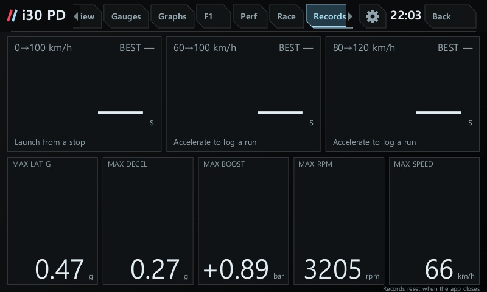

화면 목록의 `기록` 칸(예전엔 레이스 탭을 한 번 더 눌렀다). 계산은 `DriveStats`가 **어느 탭을 보고 있든** 매 화면마다 하고, 각 값의 수신 시각으로 재므로 화면 갱신 간격과 상관없다. 앱을 닫으면 초기화. 화면을 누를 필요가 없다.

- **가속 측정 3종**: `0→100 km/h`(정차 후 출발하면 자동 시작, 0.5 km/h를 넘는 순간), `60→100`, `80→120`(구간 아래 속도에서 가속해 들어가면 시작). 시작·끝 시각은 두 속도 샘플 사이를 선형으로 보간한다. 감속해 시작 속도 아래로 내려가거나 30초를 넘으면 취소. 최근 기록과 BEST.
- **최고 기록 5종**: 횡G(절댓값) · 감속G · 부스트 · RPM · 속도.

## 4. 게이지

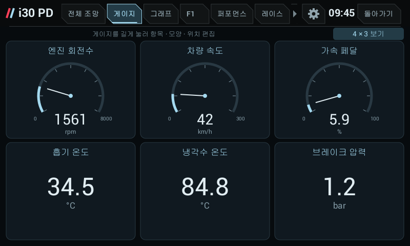
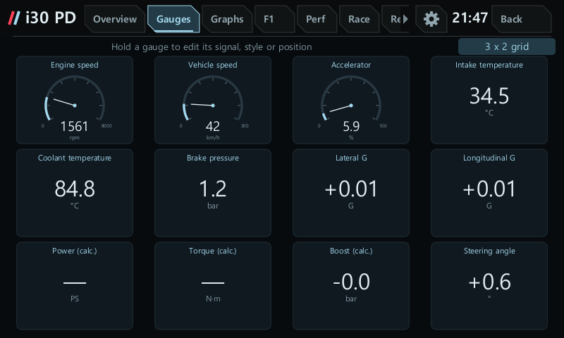

PD에서 새로 고를 수 있는 항목(순간 연료소모 · 평균 연비 · 주행가능거리 · 스로틀 개도 · 보정 토크 · 마찰 토크 · 점화 시기 · 브레이크 스위치 · 조향 토크 · 주행 모드 · 주차 브레이크 · 엔진 부하), 10/29 주행 로그 중간 지점 4×3:

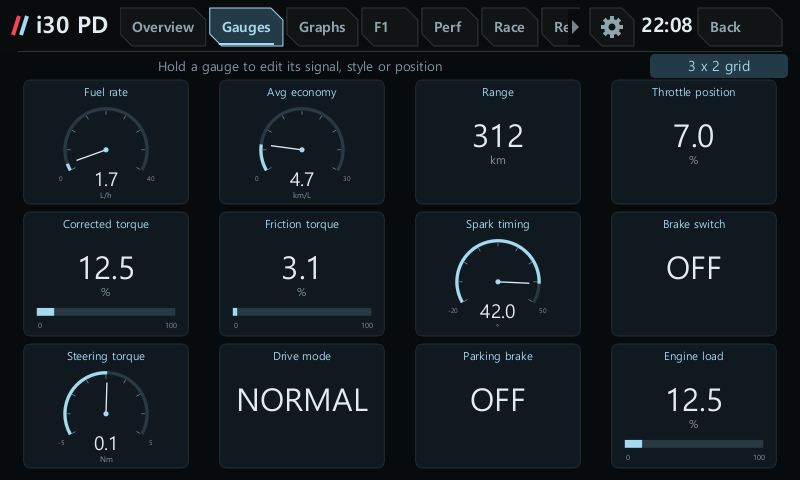

- 6칸(3×2) ↔ 12칸(4×3) 전환(우상단 버튼).
- **게이지를 길게(0.6초) 누르면 편집**: 항목(45개 신호 중 — 주행 모드·주차 브레이크는 글자로 표시) · 모양(원호 바늘 / 숫자+막대 / 큰 숫자) · 위치 교환. 저장됨.
- 기본 항목: RPM · 속도 · 스로틀 · 흡기온 · 냉각수 · 브레이크압 (+ 횡G · 종G · 출력 · 토크 · 부스트 · 조향각).

## 5. 그래프

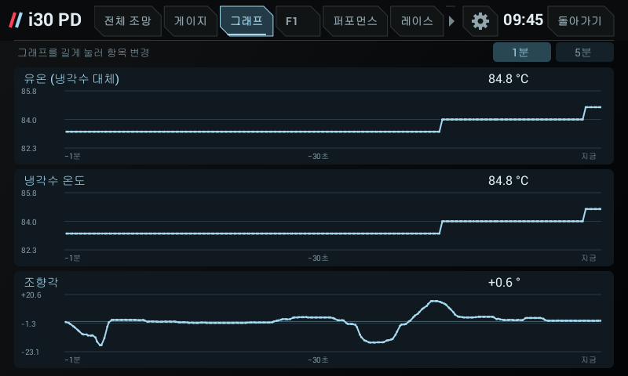
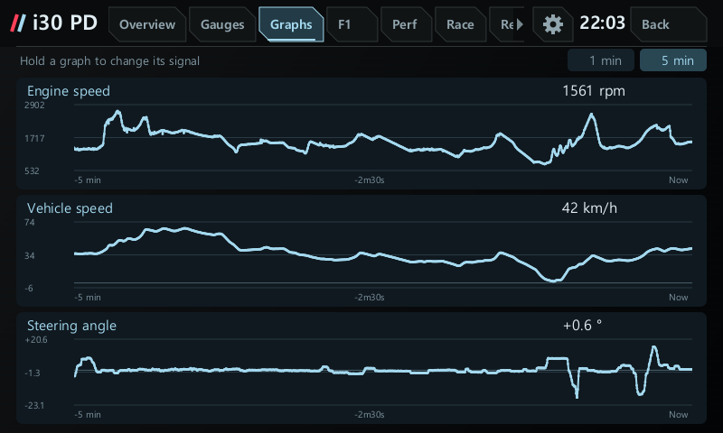

- 시계열 3줄, **1분 / 5분** 창 전환. 그래프를 길게 누르면 항목 변경(저장됨).
- 받은 값만 그린다 — 값이 끊긴 구간은 이어 붙이지 않는다(2초 넘게 비면 선을 끊음).
- 기본 항목은 오일온 · 냉각수 · 조향각인데, PD에선 앞의 둘이 아직 비어 있어 첫 화면은 빈 그래프가 된다(위 1번째). 아래는 RPM · 속도 · 조향각을 골라 5분 창으로 본 실제 주행 기록.

## 길게 눌러 칸 바꾸기 (beta, 2026-11-04)

클래식 · 레이스 · F1 · 레트로의 작은 숫자 칸은 **길게 누르면(0.6초)** 보여 줄 항목을 바꿀 수 있다. 목록은 두 단계다: 먼저 묶음(엔진 · 온도 · 터보·연료 · 변속·구동 · 주행·자세 · 브레이크·안전 · 타이어 · 전기·차체 · 디젤 DPF), 그다음 그 안의 항목. 지금 항목이 든 묶음엔 `●`, 항목엔 선택 표시. 맨 위 **기본값으로 되돌리기**. 이 차에 없는 것은 목록에 안 나온다(휘발유엔 DPF 묶음 없음, DCT엔 수동 클러치 없음, 6MT엔 DCT 클러치 온도 없음, 디젤엔 점화 시기 없음). 고른 것은 레이아웃·칸마다 `pit_vehicle_ui`(`tile_<레이아웃>_<칸>`)에 저장되고, 고른 항목이 차에 없으면 그 칸의 기본값으로 돌아간다(`Tiles`, 테스트 `TilesTest`).

- **바꿀 수 있는 칸**: 클래식 좌우 4칸씩(8칸) · 레이스 왼쪽 아래 2×2 · F1 속도·RPM 아래 두 줄 · 레트로 아래 4칸. 레이스 맨 아래 줄, F1 가속·브레이크 막대, 레트로 왼쪽 막대 묶음 등은 그대로.
- **여러 값을 한 칸에**: `타이어 공기압 (4바퀴 묶음)`(FL FR / RL RR, 바퀴마다 경고색), `DCT 클러치 온도 (홀·짝 묶음)`(빨강이면 칸 채움), `DPF (차압·온도·재생 묶음)`(디젤). 세션 값 `직전 코너 최저 속도` · `직전 코너 최대 횡가속`도 고를 수 있다.
- **기본값**: 클래식 왼쪽 냉각수 · 흡기 · 부스트 · 가속, 오른쪽은 **타이어 4바퀴 묶음 · 외기 온도 · 연료 잔량 · DCT 클러치(홀·짝)**(6MT는 엔진 부하) — 예전 바퀴별 4칸을 한 칸으로 모았다. 레이스 냉각수 · 흡기 · 스로틀 · 점화(디젤은 DPF). F1 흡기 · 냉각수. 레트로 직전 코너 최저 속도 · 최대 횡G · 횡G · 배터리.
- 게이지·그래프의 **표시 항목** 목록도 같은 묶음 목록이다(여러 값 묶음과 세션 값은 빼고 한 값짜리만).
- 프리뷰: `9a_cluster_classic`(새 기본), `x_tiles_classic` · `x_tiles_race`(칸을 바꾼 예).

## 6. 클러스터 (새 탭, 2026-10-31, 프리뷰 검증·실차 보류)

벨로스터 N 자작 게이지 4세대(네이버 블로그 rio7377 「벨로스터N 4세대 게이지 사용기」)를 참고한 계기판 화면 3가지. 화면 탭을 누르면 다음 화면으로 넘어가고, 마지막에 본 화면을 기억한다. 단수가 바뀌면 기어 숫자가 0.15초 번쩍이며 1.2배에서 줄어든다. 위 상태 칸·아래 경고 칸은 **켜졌을 때만** 불이 들어오고, i30에 신호가 없는 항목(전조등, 엔진·변속기 경고, 타이어 온도, 오일 온도, ECS·LSD)은 넣지 않았다.

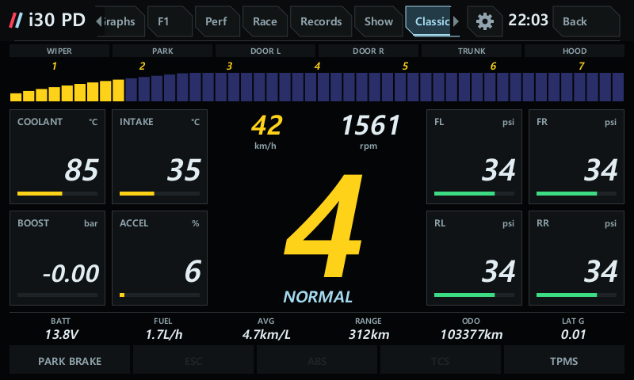

- **클래식**(좌우 대칭, 테마 강조색 사용 — N은 노랑): 와이퍼·주차·문·트렁크·후드 상태 칸, 계단형 회전 곡선(레드라인 넘으면 경고색) 위에 단수 숫자. 왼쪽 2×2 엔진 칸(냉각수·흡기·부스트·가속, 값 + 막대)과 오른쪽 2×2 타이어 칸(FL·FR·RL·RR psi, 막대 정상 초록 / 30 psi 미만 앰버 / 26 미만 경고색 + 테두리)이 같은 모양으로 마주 본다. 가운데 위 속도·RPM, 큰 이탤릭 기어, 아래 주행 모드(6MT는 옆에 변속 권장 `▲4`). 하단 라벨 6칸 BATT·FUEL(L/h)·AVG(km/L)·RANGE·ODO·LAT G, 경고 칸 PARK BRAKE·ESC·ABS·TCS·TPMS.

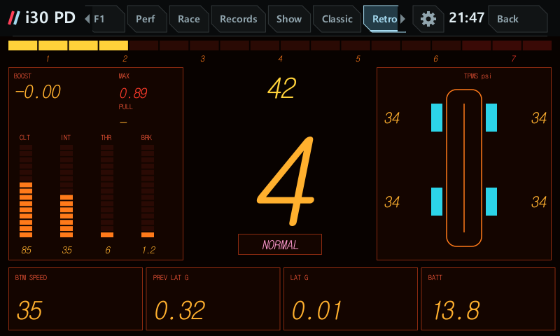

- **레트로**(사이버포뮬러 느낌, 테마와 상관없이 주황 LCD 색): 세그먼트 회전 막대, 부스트와 세션 최대(MAX)·직전 가속 최대(PULL), 냉각수·흡기·가속 페달·브레이크 압력 막대, 차 윗모습 위 공기압, 아래 **코너 최저 속도(BTM SPEED)·직전 코너 최대 횡G·현재 횡G**·전압.
  - 코너 = 횡G 0.25 g 이상이 1초 넘게 이어진 구간. 0.5초 동안 그 아래면 끝나고 그 구간의 최저 속도·최대 횡G를 굳힌다. 가속 = 가속 페달 70% 이상이 0.5초 넘게 이어진 구간, 0.3초 떼면 그 구간 최대 부스트를 굳힌다(툭 밟은 건 기록 안 함). 화면을 숨겨 1초 넘게 값이 비면 진행 중이던 코너·가속은 버린다. 문턱은 실차로 조정 예정.

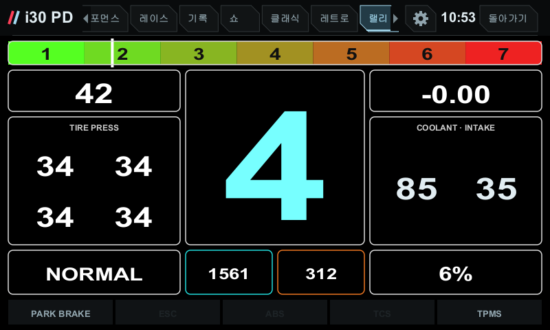

- **WRC 랠리**: 흰 둥근 칸에 옆으로 넓은 굵은 숫자만. 단수마다 초록→빨강 한 칸인 회전 막대(흰 선이 현재 RPM), 속도·부스트·공기압·냉각수/흡기·주행 모드·RPM·주행가능거리·가속.

### 클러스터 레이아웃 17개 (테스트 버전, 2026-11-01, 프리뷰 확인·실차 보류)

**화면 목록**: 머리의 화면 탭을 **짧게 누르면 다음 화면**, **0.6초 길게 누르면 목록**(6×5)이 뜨고 칸을 눌러 바로 고른다(바깥을 누르면 닫힘). 목록에는 25개 화면이 모두 들어 있다 — 전체 조망·게이지·그래프·F1·퍼포먼스·레이스·기록·쇼, 그리고 아래 레이아웃 17개. 예전처럼 퍼포먼스·레이스를 한 번 더 눌러 쇼·기록으로 가는 방식은 없어졌고, 쇼·기록도 목록의 한 칸이다.

- **설정**(시계 왼쪽 톱니바퀴): 왼쪽에 분류(`화면 · 테마 · 차량 색 · 주행 모드 · RPM · 사운드 · 언어 · 진단 · 완료`), 오른쪽에 고른 분류의 목록이 나온다. 누르는 즉시 적용·저장되고, `완료`나 톱니바퀴를 다시 누르면 닫힌다.
  - `RPM`: **변속 목표**(레이스 `SHIFT ▲`·F1 LED, F1 탭 `− / +`와 같은 값)와 **레드라인**(HUD·VFD·8비트의 SHIFT/REV LIMIT 경고, 레이스 RPM 빨간 글씨, 여러 화면의 빨간 구간; 기본 가솔린 6500·디젤 4600, 가솔린 5000~7000·디젤 3500~5000)을 `− / +`로 100 rpm씩 바꾼다. 이름 쪽을 누르면 기본값으로 돌아간다. 레드라인을 낮추면 변속 목표도 그 아래로 내려온다.
    **변속 알림음**(기본 끔): 변속 목표에서 깜빡임이 켜지는 순간 짧은 소리 한 번(깜빡이는 동안 반복 없음, 1.5초 안에는 다시 안 울림, 주행 중·최고단 아닐 때만). **알림음 종류**를 누를 때마다 삐빅 → 삑 → 상승 3음 → 레이스 버저 → 틱틱으로 바뀌고 한 번 들려 준다. **알림음 음량**은 `− / +`로 10%씩(기본 70%, 이름 쪽을 누르면 70%). 소리는 아래 `사운드`의 알림 채널과 같은 길(`STREAM_NAVI` + 마이컴 `startAudio(0x41)`)로 나가 앞 스피커에서 라디오·내비 위에 섞인다. 엔진 사운드가 그 길로 나오고 있으면 알림음을 엔진 소리 스트림에 섞어 넣는다(따로 열면 엔진 소리에 가려 들리지 않았음, 실차 확인). 엔진 소리는 끊기지 않는다(`ShiftBeep`, `ShiftGuide.Beep`, `EngineSound.mixBeep`).
    **람다에서**: 6MT 클러치를 밟은 동안에는 변속 알림음이 울리지 않는다(다운시프트 블립이 업시프트 목표를 넘는 일이 잦음, 6MT 차주 요청 2026-11-05). 대신 **1단·2단·3단 아래 맞춤 소리**(기본 끔, 눌러서 끔 → 알림음 종류 차례로): 클러치를 밟고 블립한 RPM이 그 단의 목표 ±100에 들어오는 순간 한 번(같은 단은 0.8초 안에 다시 안 울림, `RevMatch.Cue`). 음량은 알림음 음량을 같이 쓴다. 아랫단 목표 선은 3 px·불투명에 가깝게(전에는 1.6 px·40 %라 8인치 화면에서 어둡고 계단처럼 보였음).
  - `사운드`: v1.8.6~v1.8.9에는 꺼 두었고(`엔진 사운드 · 사용 안 함` 한 줄) v1.8.10에서 다시 켰다(`SettingsLayout.ENGINE_SOUND`, 기본 끔). **엔진 사운드** — 받은 RPM·가속 페달·부스트로 엔진 소리를 합성해 낸다(`EngineSynth`, 녹음 파일 없음). 계기판이 열려 있고 시동이 걸려 있을 때만, 후진이면 조용하다. **출력 경로**는 누를 때마다 바뀐다: `알림 채널 · 앞 스피커`(기본, 실차에서 유일하게 소리가 나는 길, 라디오·내비 위에 섞이고 저음은 없음) · `내비 효과음` · `미디어 소스` · `안드로이드 기본`(셋은 이 차에서 무음으로 확인, 다른 헤드유닛용으로 남겨 둠). **엔진**(1.6 터보 4기통·직렬 6기통 터보·V6 트윈터보·V8 크로스플레인·V8 플랫플레인)과 **배기**(순정·스포츠 머플러·중통 제거·풀 배기 · 팝앤뱅)를 따로 고르고, **음량** 10~100 %, **팝 빈도·터보 휘슬·블로오프** 0~200 %, **지연 보정** 0~150 ms(CAN으로 늦게 오는 RPM을 기울기로 앞당겨 예측)를 `− / +`로 바꾼다. 소리는 [체험 페이지](https://claude.ai/artifact/KKyyDju6TZ1jEgyZV5Bf9y)와 같은 알고리즘이다.
  - `화면`: 24개 화면마다 `사용`/`미사용`. 미사용 화면은 탭 줄·목록에 안 나오고 넘길 때도 건너뛴다. 마지막 남은 사용 화면은 끌 수 없고, 지금 보던 화면을 끄면 다음 사용 화면으로 넘어간다.
  - `테마`: 10개 테마를 색 견본과 함께 나열(아래 "테마"). `차량 색`: 8비트 두 화면의 차 색 9가지(아래).
  - `주행 모드`(둘 다 기본 끔): **모드 색** — ECO는 초록, SPORT는 주황빨강으로 모든 화면의 강조색이 바뀐다(경고 빨강과는 다른 색). **모드 화면** — 주행 모드를 바꾸면 그 모드의 화면으로 넘어간다. 아래 SPORT·ECO·NORMAL 줄을 누르면 화면 목록이 열려 모드마다 화면을 고른다(기본 SPORT→F1, ECO→에코, NORMAL→원래 화면). `원래 화면`은 처음 넘어가기 전에 보던 화면으로 돌아가는 것이고, 그 사이 직접 다른 화면으로 옮겼으면 그대로 둔다. 미사용 화면으로는 넘어가지 않는다.
  - `언어`: 시스템 / 한국어 / English. `진단`: 고장코드 조회 창(아래 "고장코드 조회"), **실제 속도로 표시**(GPS 속도 보정, 기본 끔, beta 2026-11-05): GPS 속도 ÷ 차 속도를 늘 배우고(정속 40~130 km/h·3초 동안 ±2 km/h·직진 요레이트 3°/s 이하·브레이크 안 밟음·GPS 정확도 10 m 이내·GPS 속도 연속 두 번 ±2 km/h, 차 속도는 위치가 오기 전 1초 평균), 표본 120개부터 최근 600개의 중앙값을 비율로 쓴다(0.90~1.10 밖은 버림, 비율·표본 수 저장). 켜면 화면의 차량 속도(모든 화면·게이지·그래프)와 측정(제로백·60→100·80→120, 최고 속도)에 곱한다. 수동 단수 판정, DCT 학습 기어비, 내릴·올릴 단 RPM, 변속 측정값, 택시 미터 거리는 차 속도 그대로. 설정 줄에는 "GPS로 속도계 오차 재는 중 · n %" → "속도계가 실제보다 3.3 % 높게 나옴"처럼 나오고, `속도 GPS 보정 값 초기화`로 처음부터(`SpeedCal`, 프리뷰 `9_settings_diag_speedcal`). GPS가 주는 속도와 펌웨어의 GNSS/DR 항목은 첫 위치 때 한 번 `GPS fields:` 줄로, 1분마다 `GPS … speed`로 기록에 남는다.
- **저장**: 지금 화면(`cluster_screen`)과 미사용 목록(`cluster_hidden`, 비트 마스크)을 `pit_vehicle_ui` 설정에 저장해서 재부팅 뒤에도 유지된다. 대시보드는 마지막에 보던 화면으로 열린다(처음엔 전체 조망). 예전 `cluster_layout` 값은 쓰지 않는다.

| 설정 · 화면 | 설정 · 주행 모드 | 모드 화면 고르기 |
|---|---|---|
| 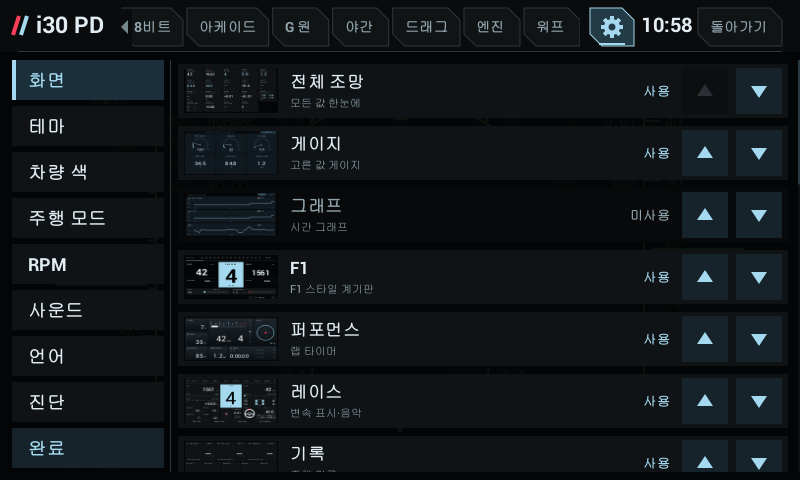 | 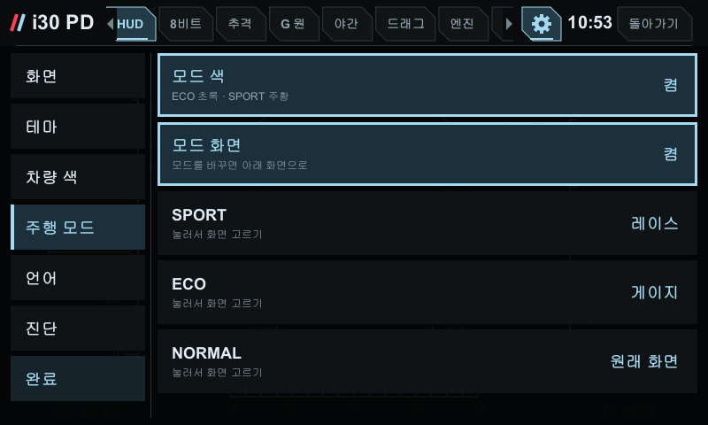 | 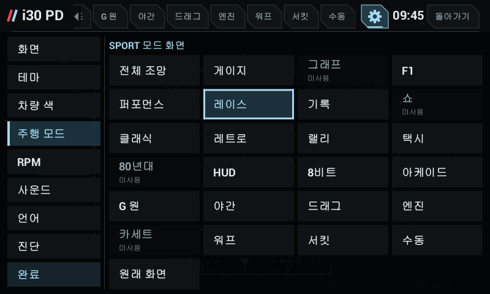 |
| **설정 · RPM (변속 알림음)** | **설정 · 사운드** | |
| 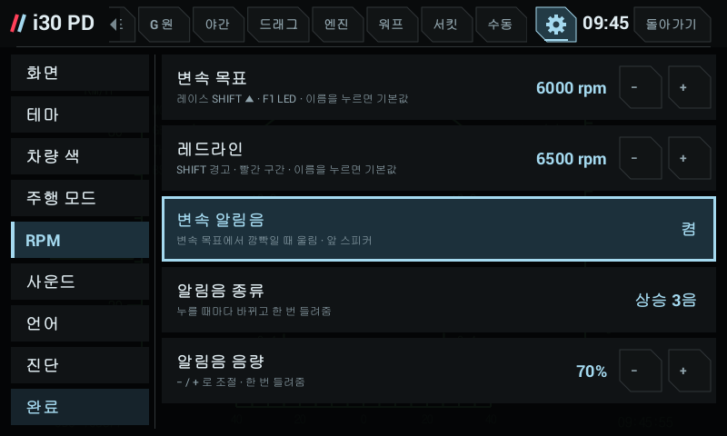 | 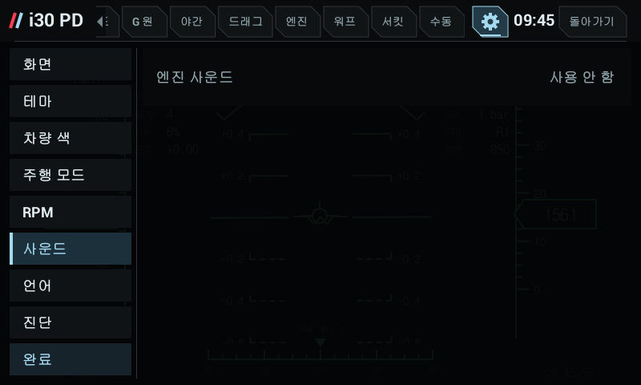 | |

새 11개 레이아웃은 각자 색을 쓰고(마찰원·드래그·야간·엔진·워프는 테마의 강조색을 따름), 그래프와 꼬리는 텔레메트리 기록(250 ms, 5분)에서 그려 탭을 연 순간부터 채워져 있다. 그림자·빛 번짐은 쓰지 않는다(헤드유닛은 소프트웨어로 그림).

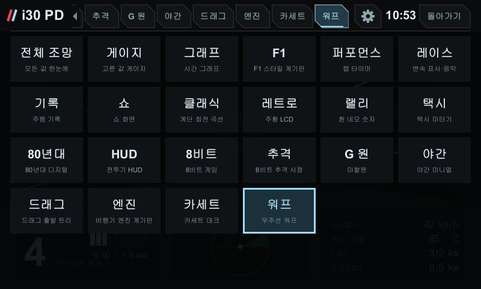

| 택시 미터기 | 80년대 디지털 | 전투기 HUD |
|---|---|---|
| 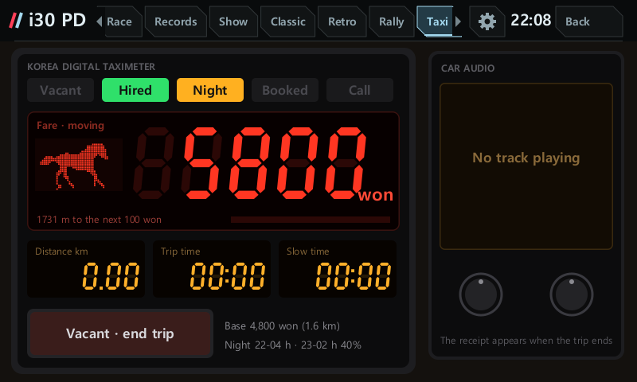 | 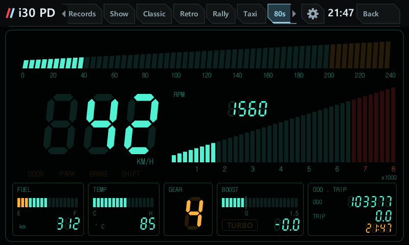 | 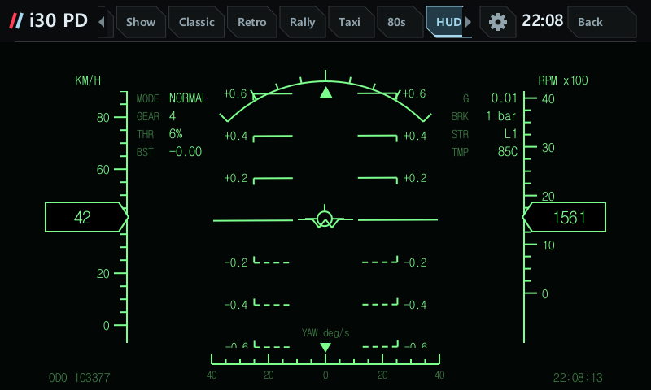 |
| **8비트 게임** | **8비트 아케이드** | |
| 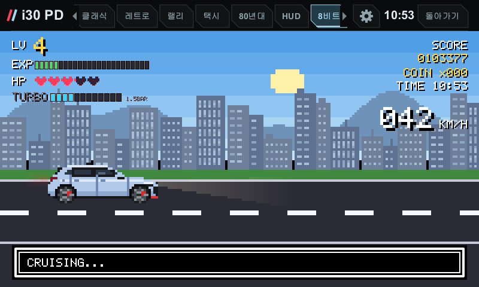 | 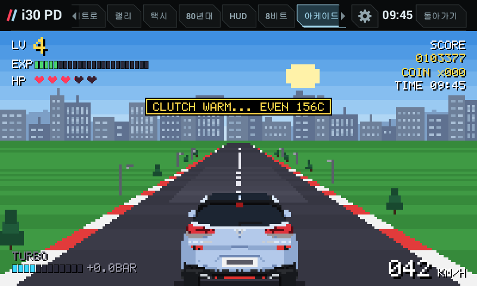 | |
| **8비트 · 밤** | **아케이드 · 밤** | **마찰원** |
| 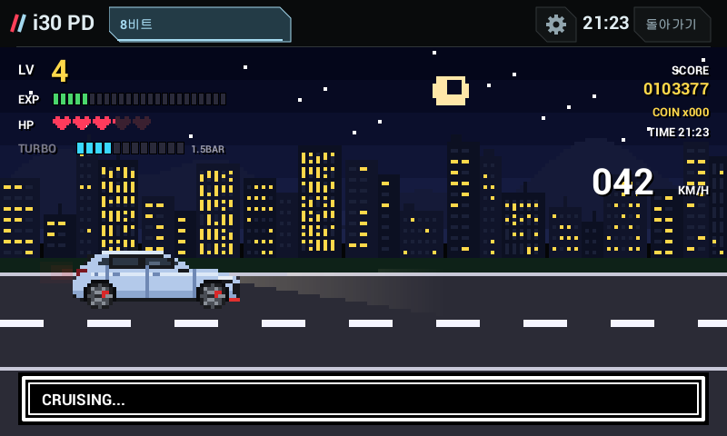 | 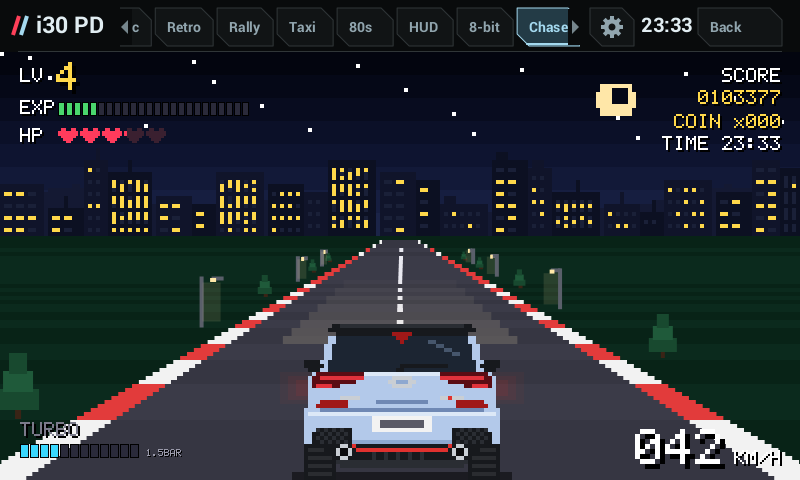 | 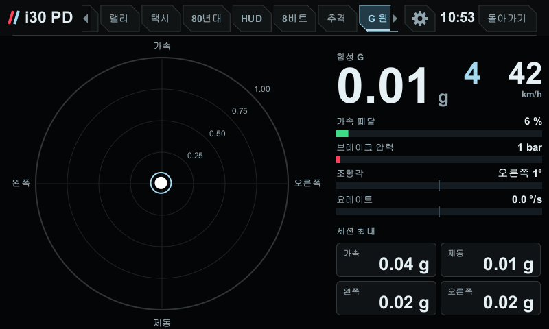 |
| **야간 미니멀** | **드래그 출발 트리** | **비행기 엔진 계기판** |
| 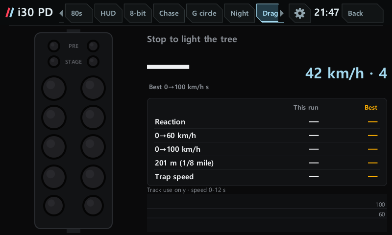 | 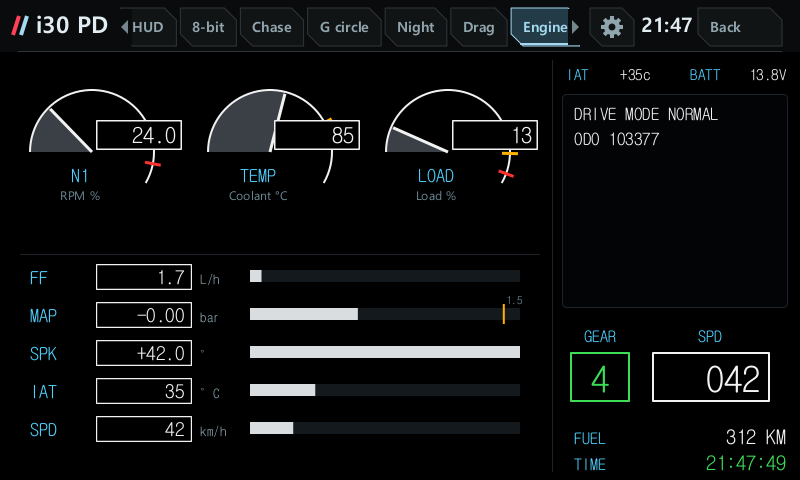 | 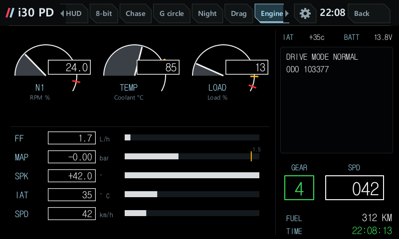 |
| **카세트 데크** | **우주선 워프** | |
| 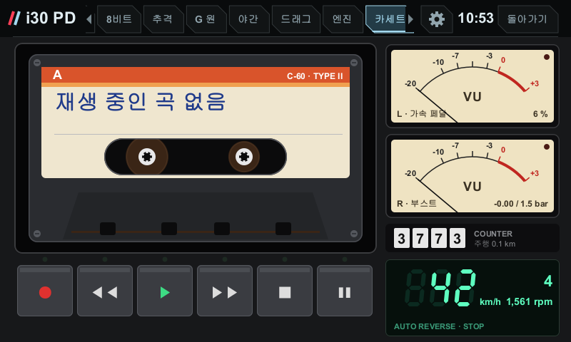 | 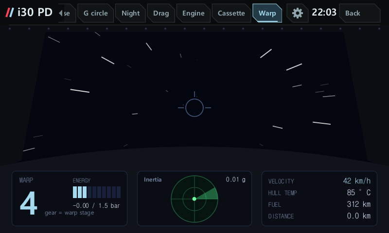 | |

- **택시 미터기**: **미터기를 켠 지역의 중형 요금**(전국개인택시연합회 '시, 도별 개인택시 요금현황', 17개 시·도, 2026-11-04에 읽음). 헤드유닛 GPS로 지금 있는 사업구역(특별·광역시·세종·제주는 통째로 하나, 도는 시·군 하나씩, 경계: 통계청 SGIS·vuski/admdongkor 2026-10, 200 m 단순화)을 알고, 운행을 시작한 곳의 요금표를 그 운행 내내 쓴다. 다른 시·군으로 3초 넘게 들어가면 그 요금표의 **시계외 할증**이 붙고(머리 줄 `시계외` 주황), 심야와 겹치면 표의 복합할증(부산 40·50%처럼 단순 합이 아닌 곳은 표 값, 빈칸·시군별은 합). 예: 서울은 기본 4,800원(1.6 km), 131 m마다 또는 15 km/h 이하 30초마다 100원(실제 미터기처럼 **거리·시간 병산**: 15 km/h 넘으면 거리만, 이하면 시간만 세고 기본 거리도 둘을 합친 거리로 소진), 22~23·02~04시 20%, 23~02시 40%, 시계외 20%(그 시각에 올라간 단위에만 붙어, 끝난 영수증은 시각이 바뀌어도 그대로), 할증은 100원 단위 반올림. 표에 없는 세종은 서울 요금(머리 줄 `세종 · 서울 요금`), 제주는 20 km부터 한 번에 120원. GPS가 없으면 마지막으로 잡힌 지역(처음엔 서울) 요금이고 머리 줄에 `GPS 없음`. 다른 화면을 보는 동안에도 요금·거리·시간이 계속 올라간다(VFD TRIP, 에코 연료, 워프 거리도 같음). 차가 움직이면 미터가 켜지고 `빈차 · 운행 종료`로 끝낸다. 요금판 옆 LED 창에서 실제 말 영상에서 한 보폭(10장면)을 따 온 말이 속도에 맞춰 달린다(100 km/h 이상이면 영상과 같은 0.4초 보폭). 오른쪽 칸은 평소엔 **카오디오**(재생 소스, 재생/일시정지, 곡 제목 두 줄, 가수, 진행 막대)이고, `빈차 · 운행 종료`를 누르면 그 운행의 **영수증**으로 바뀐다. 영수증을 누르면 다시 음악으로, 다음 운행이 시작돼도 음악으로 돌아간다. 달리는 중에 운행을 끝내면 한 번 멈춰 선(3 km/h 이하) 뒤에야 다음 운행이 시작돼 영수증이 바로 사라지지 않는다.

| 운행 중 (음악) | 운행 종료 (영수증) | 부산에서 켜고 양산으로 (시계외) |
|---|---|---|
| 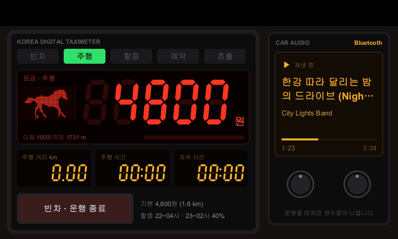 | 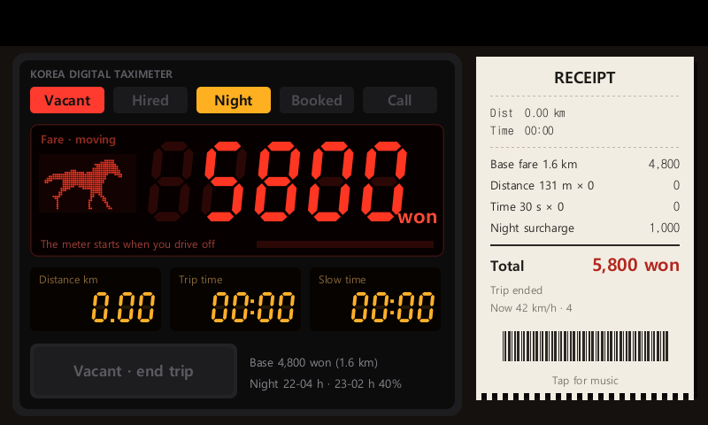 | 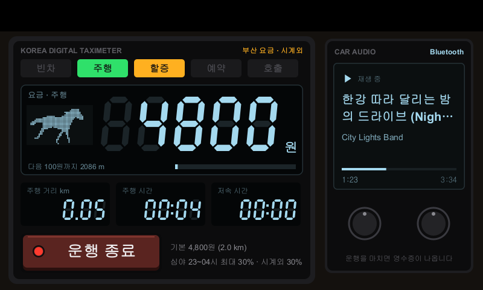 |

- **서킷**(GPS 랩 타이머): 국내 서킷 6곳(인제 스피디움, KIC 풀코스·상설, 태백 스피드웨이, AMG 스피드웨이, 포천 레이스웨이; OpenStreetMap 트랙 선, 우리 차로 달릴 수 없는 전용 시설은 뺌)을 **미니맵**(북쪽이 위)으로 보여 주고, 지금 위치(빨간 점)·출발선(체크무늬)·이번 랩 경로(하늘색)를 겹쳐 그린다. 점은 1초에 한 번 오는 위치 사이를 직전 속도로 트랙을 따라 미리 움직여 부드럽게 간다.
  - **어느 서킷인지**: 기본은 `자동 · 가장 가까운 서킷` — 서킷 안이면 그 서킷, 밖이면 가장 가까운 서킷을 보여 주고 아래에 `서킷까지 ○○ km`(1 km 넘게 떨어지면 점은 안 그림). 서킷 이름을 누르면 목록(자동 + 가까운 순, 거리)이 열리고 하나를 고르면 그 서킷으로 고정된다(앱을 닫으면 자동으로). KIC 풀코스·상설처럼 땅을 같이 쓰는 코스는 자동일 때 차가 달리는 쪽으로 바뀐다(다른 코스에서 30 m 넘게 벗어나고 이 코스에서 15 m 안).
  - **랩**: 출발선은 서킷마다 정해져 있다(수동 지정 없음). 피트·진입로로 들어와 중간에 합류한 아웃랩은 재지 않고, 출발선을 처음 지나는 순간 1랩이 시작된다. 주행 방향을 아는 5곳(OSM 일방통행 표시, KIC는 서킷맵으로 확인)은 그 방향으로 지날 때만 시작하고, 포천은 처음 지나는 방향을 따르되 초속 5 m 이상으로 움직일 때만(출발선 위 GPS 흔들림 무시). 그 뒤 같은 방향으로 다시 지날 때마다(출발선 좌우 30 m, 20초 이상) 랩이 넘어가고, 1초 간격 위치 사이에서 선을 넘은 시각을 보간해 0.1초 안팎까지 맞춘다. 피트 레인이 출발선 옆 30 m 안이면 피트 통과도 랩으로 센다(실제 계측과 같음).
  - **오른쪽 칸**: 지금 랩 시간, **최고 랩 대비 실시간 차이**(최고 랩의 같은 지점과 비교, 초록 = 빠름·빨강 = 느림, 막대 한쪽 끝 = 2초), BEST·LAST·**예상 랩**(최고 랩 + 지금 차이), 속도·단수·RPM 막대(레드라인부터 빨강), **최고 속도**(이번 랩 / 지난 랩), 냉각수·DCT 클러치 온도(주황·빨강 경고), `초기화`(3초 안에 두 번 눌러야 지움). 기록은 앱을 닫으면 사라진다.
  - **출발선 출처**: 인제는 2025 슈퍼레이스 공식 서킷맵의 컨트롤라인, 태백·AMG는 서킷맵의 출발선(태백 10번과 1번 사이, AMG 17번과 1번 사이 직선), KIC 풀코스는 OSM 결승선 표시, KIC 상설·포천은 피트 옆 직선 가운데로 추정(지도에 `출발선 위치는 추정`, 랩 시간 자체에는 영향 없음).

| 인제 스피디움 | 서킷 목록 (서울에서) | 서킷 밖 (자동: 가장 가까운 곳) |
|---|---|---|
| 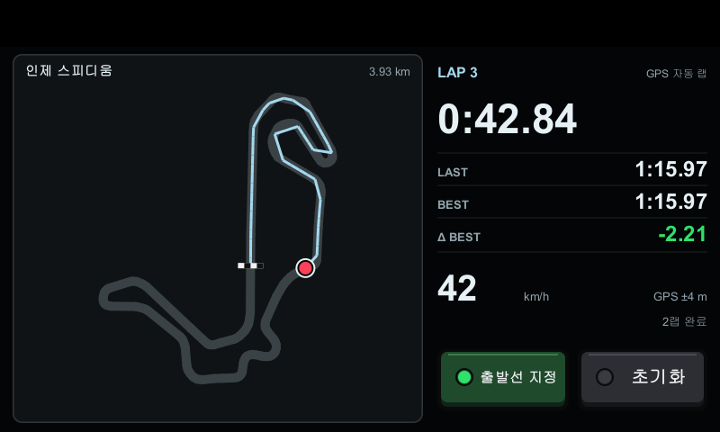 | 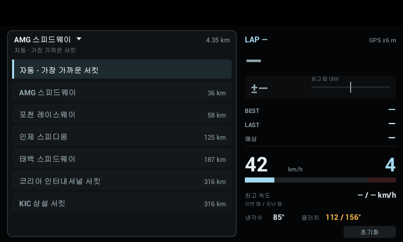 | 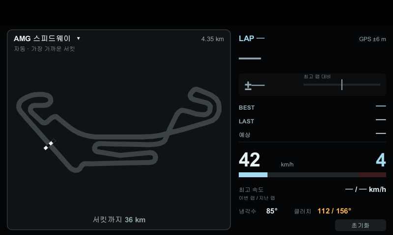 |

- **80년대 디지털**: 청록 VFD, 계단 속도 막대·오르막 RPM 막대, 0.4 bar 넘으면 TURBO 램프.
- **전투기 HUD**: 횡G로 기울고 종G로 오르내리는 사다리, G 방향 표시, 속도·RPM 테이프, 요레이트 눈금, 레드라인 500 rpm 전부터 SHIFT.
- **8비트 게임 / 8비트 아케이드**(탭 이름 `8비트` · `아케이드`): 도트 i30 N(PD). 차 색은 톱니바퀴 설정의 `차량 색`에서 고르며(기본 N의 퍼포먼스 블루, 그다음 국내 i30(PD) 색: 폴라 화이트 → 파이어리 레드 → 팬텀 블랙 → 아이언 그레이 → 스타게이징 블루 → 데미타스 브라운 → 인텐스 블루 → 라바 오렌지, 2016년 출시 색 중 빠졌던 마리나 블루 → 플래티넘 실버 → 인텐스 카퍼, 순정 색이 아닌 미드나이트 퍼플 → 카키, 저장됨), 두 화면 모두에 같이 적용된다. 옆모습은 현대 공식 측면 사진을 46칸으로 축소한 윤곽이다. 아케이드의 뒷모습은 Sketchfab 3D 모델을 13개 각도(−24°~+24°, 4° 간격)로 그려 앱 팔레트로 줄인 도트 표(`ArcadeCarFrames`, 출처는 [`NOTICE.md`](../../NOTICE.md))이고, 커브에서는 길이 휘는 값의 20배만큼 차가 돌아간다(핸들 30° → 4°, 90° → 16°). 브레이크·미등·깜빡이(차체 쪽 미등 아래 투명한 띠와 사이드미러 끝)·차 색은 앱이 그 자리에 칠한다. 추격 시점은 뒤에서 따라가는 3인칭이고 도로가 핸들 조향으로 휜다. 차는 도로 가운데에서 핸들 쪽으로 살짝 기운다(최대 6점, 직진 중 ±2° 흔들림은 무시, 부드럽게 따라감). 반응하는 것만 보일 만큼이고 차선을 옮기지는 않는다. 노면 충격: 변속·가속 페달·브레이크·조향 변화 없이 좌우·앞뒤 G가 한 샘플만 튀면(2차 차분 0.15 G 넘음, ESP12 초당 약 12번) 차와 화면이 짧게 덜컥인다. 위아래 가속도 센서는 없어 추정이고, 10/29 시내 로그 기준 주행 중 약 11초에 한 번이다(과속방지턱 로그로 기준을 다시 맞출 것). 브레이크·변속은 덜컥이지 않고 지평선 높이와 기울기로만 보인다. LV=단수, EXP=RPM, 하트=주행가능거리 100 km, SCORE=주행거리, 연료 차단 1초=코인. 글자는 모두 5×7 도트 글꼴(코드에 넣은 글자, 문자열마다 그림자까지 한 번 그려 두고 한 번에 찍음, 최근 64개 보관). 상향등은 하향등 위로 수평으로 멀리 은은하게 뻗는다(추격 시점은 먼 노면까지 밝아짐). 주행 모드: 바뀌면 대화창에 1.5초 안내, 평소 대사도 모드별(`CRUISING...` / `ECO RUN...` / `BATTLE MODE...`). ECO는 연료 차단 코인 2배와 뒷바퀴에서 날리는 나뭇잎 몇 장, SPORT는 차체 1칸 낮춤과 옅은 속도선(추격 시점은 소실점에서 퍼짐). 모든 모드에서 3000 rpm 넘게 밟다가(40 %+) 0.7초 안에 떼면 배기구에 백파이어가 0.45초. 2500 rpm 넘게 밟다가(20 %+) 떼면 1.3초 안에 짧은 불꽃이 한두 번 튄다. 엔진 사운드가 켜져 있으면 그 소리의 큰 팝에 맞춰, 꺼져 있으면 페달을 뗀 때를 기준으로 낸다.
  - **하늘**은 시계(서울 월별 일출·일몰, 앞뒤 30분은 노을)로 낮·노을·밤을 바꾸고(`DayPhase`, 테스트), 가로등과 중간층 도시 스카이라인의 창 불빛(건물마다 다른 비율·창 모양, 해시로 흩뿌림)도 하늘을 따른다. 맨 뒤는 산.
  - **날씨**(`Weather`, 테스트)는 차 신호로 정한다: 와이퍼가 20초 넘게 돌면 비(HIGH면 폭우, 외기온 1°C 이하면 눈), 와이퍼가 1분 꺼지면 그친다. 와이퍼가 안 돌아도 영하면 눈 덮인 겨울 땅, 5°C 미만이면 마른 잔디와 옅은 하늘. 낮에 전조등이 5분 넘게 켜져 있으면(스위치 AUTO) 흐림, 1분 꺼지면 갠다. `차량 색` 맨 끝 `8비트 하늘`(자동 → 맑음 → 흐림)로 하늘을 고정할 수 있다. 흐리면 해·달·별이 사라지고 낮에는 도트 구름, 비·눈은 4×4 장면 픽셀로 내린다(아케이드는 소실점에서 퍼지고, 옆 화면은 뒤로 비스듬히). 젖은 길은 어둡고 뒷바퀴에서 물보라가 튄다. 밤에는 하늘은 그대로, 땅과 젖은 길만 바뀐다.
  - **8비트 규칙**: 장면의 모든 것은 4×4 화면 픽셀 격자에 맞고, 반투명은 쓰지 않는다(빛·번짐·연기는 단색이나 디더링). HUD 글자는 2 또는 4픽셀 단위. `preview/pixelcheck.sh`가 낮·밤, 등·브레이크·깜빡이·부스트·SPORT, 날씨 7가지에서 확인한다.
  - **차 조명은 차 신호 그대로**, 낮에도: 전조등·미등은 새 신호 53 `HEAD_LAMP`(CGW1 `HeadLampLow`, 슬롯 `0x01` byte3 bit7), 제동등은 브레이크 압력, 깜빡이는 신호 비트(실제 램프와 같이 점멸)로 차 램프에서만 보인다(옆모습은 보이는 왼쪽만).
- **마찰원**: 최근 4초 G 꼬리, 방향별 세션 최대, 페달·브레이크·조향·요레이트 막대.
- **야간 미니멀**: 큰 속도 하나와 얇은 RPM 선. 문·트렁크·후드 열림, 공기압 30 psi 미만, 냉각수 110°C, 주행 중 주차 브레이크일 때만 아래 칸이 켜진다.
- **드래그 출발 트리**(트랙 전용): 1.5초 정차하면 노랑 3개 → 초록. 초록 전에 출발하면 빨강. 반응·0→60·0→100·201 m·통과 속도, 세션 최고.
- **비행기 엔진 계기판**: N1(레드라인 대비 RPM %)·냉각수·부하 다이얼, FF·MAP·SPK·IAT·SPD 막대, 색 메시지 창, 초록 GEAR 칸.
- **카세트 데크**: 재생 중인 곡이 라벨에, 곡 진행만큼 테이프가 감김. 릴은 RPM, VU는 페달·부스트.
- **우주선 워프**: 별 160개가 속도만큼 날아옴(부스트면 푸른빛), 워프 단계=단수, 에너지=부스트, 관성 레이더=G, 급제동 빨간 경보.
- **오실로스코프**: XY = 횡G·종G 3초 잔상, 위쪽 RPM 5초, 주파수 계수기 = RPM ÷ 60.
- **점화·노킹 모니터**: 노킹 센서 값은 버스에 없다. 풀부하(페달 70% 초과, 부스트 0.3 bar 초과)에서 점화가 우리 차 로그의 풀부하 선(약 13 − 9 × 부스트 °)보다 늦으면 그만큼을 "지각 추정"으로 표시(`SparkRetard`, 테스트 포함). 튜닝 차는 이 선에서 벗어날 수 있다.
- **그리기 비용**: 한 장당 그리기 명령 수(헤더 제외, PC에서 셈) — 야간 15 · G 원·랠리 51 · 엔진 73 · 드래그 83 · 노킹 98 · 레트로 136 · 클래식 145 · 8비트 147 · HUD 149 · 카세트 166 · 워프 227 · 오실로 234 · 택시 316 · 아케이드 332(밤 375, 비 495, 폭우 697, 눈 431) · 80년대 409. 서킷은 트랙 선(점 130~270개)과 출발선을 서킷·테마가 바뀔 때 한 번 비트맵에 그려 두고 찍어 인제·AMG 약 220(이전 490·510), KIC는 이번 랩 선 길이에 따라 200~400(이전 960). 택시 구역(23,000점)·서킷 자료는 GPS를 켤 때 백그라운드 스레드에서 미리 푼다(첫 위치가 오는 장면에서 수백 ms 멈추지 않게). 8비트 두 화면의 차(조명 상태별)·도시·산·하트·전조등 빛과 택시의 말은 처음 한 번 작은 비트맵에 그려 두고 찍는다(처음엔 8비트 1,940·아케이드 1,330·택시 613; 물보라·밤 번짐의 바둑판 무늬도 크기별로 한 번 그려 두고 찍는다). 실차 시간은 logcat `VehicleDash` 5초 줄 끝의 `draw avg … max … ms`로 본다(하드웨어 가속이면 기록 시간).
- **부스트 막대 범위**: 모든 탭(클래식·레이스·쇼·새 레이아웃)이 1.5 bar까지 그리고, 이번 주행에서 그보다 높은 부스트가 나오면 0.5 bar씩 늘린다(`DriveStats.boostTop`).

## 테마 (2026-10-31, 프리뷰 검증·실차 보류)

톱니바퀴 설정의 `테마`에서 **N · 람보(LB) · BMW(M) · 아이스(IC) · 모노(MO) · 앰버(AM) · 틸(EV) · 나이트(NT) · 로즈(RS) · 코퍼(CU) · 레드(RD) · 그린(GR)** 중 하나를 누르면 모든 탭 색이 바뀌고, 고른 테마는 저장된다. N은 지금까지와 같은 화면(헤더 아래는 픽셀 단위로 동일, `preview/BodyDiff.java`로 비교). 람보는 칸 네 모서리를 깎고 숫자를 굵게, BMW는 칸을 둥글게 하고 헤더 위에 M 삼색 띠. 로즈는 BMW처럼 둥근 칸(띠 없음), 코퍼는 람보처럼 육각 칸(숫자 굵기는 보통). 쇼 탭의 주행 모드별 강조색은 N에서만. 경고(과열·공기압·문/트렁크/후드 열림·주차 브레이크·ESC/ABS/TCS)는 테마와 무관한 경고색이고, 앰버에선 흰 테두리를 더해 강조색과 구분한다.

아이스·모노·앰버·틸·나이트는 차량 계기판 색을 따온 테마다. 이들과 로즈(분홍)·코퍼(구리색)·레드·그린(라임)은 배경이 완전 검정(#000000)이라 밤에 화면이 덜 번진다. 레드는 강조색이 빨강이라 경고가 노란색이 되고 앰버처럼 테두리로도 표시된다. 그린의 라임은 정상 표시용 초록·ECO 초록과 겹치지 않게 골랐다. 레이스 탭 평균 밝기(0~255): N 45.3 · 람보 43.2 · BMW 41.8 · 아이스 36.3 · 모노 41.5 · 앰버 34.1 · 틸 35.8 · 나이트 26.7(글자까지 어둡게 한 야간용) · 로즈 38.1 · 코퍼 34.3(2026-11-02 레이스 탭 배치 변경 후) · 레드 30.2 · 그린 39.2(2026-11-03).

| 람보 | BMW | 아이스 |
|---|---|---|
| 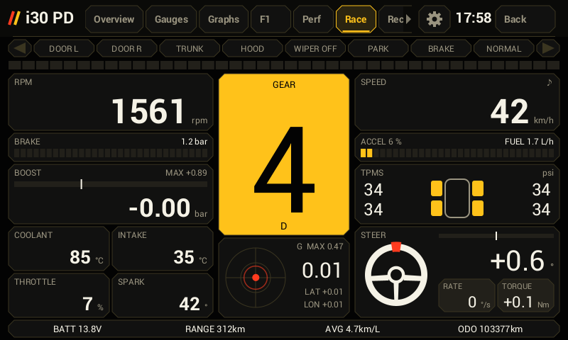 | 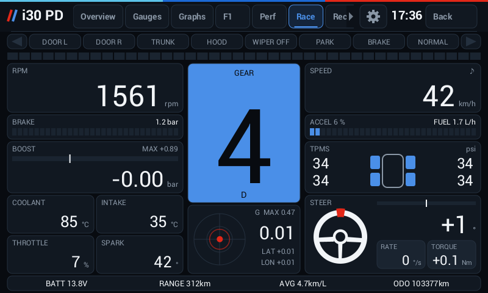 | 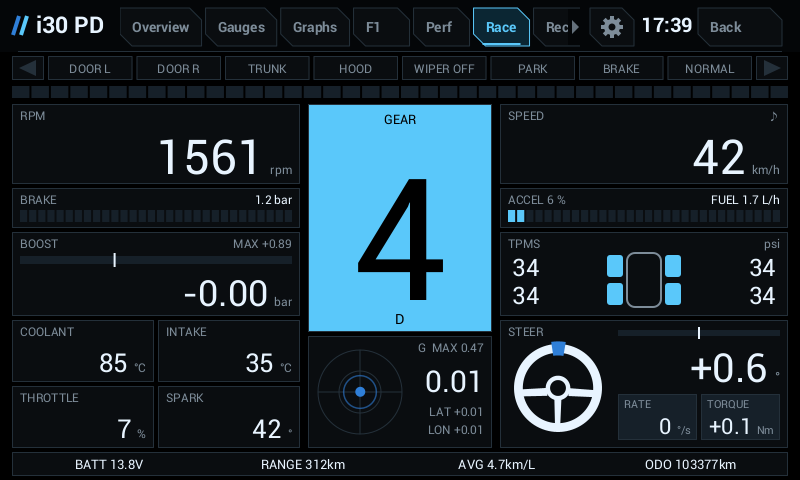 |

| 모노 | 앰버 | 틸 |
|---|---|---|
| 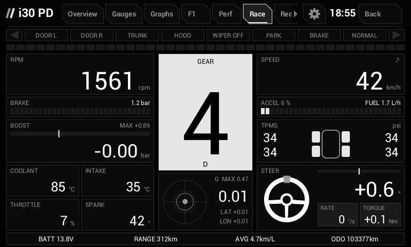 | 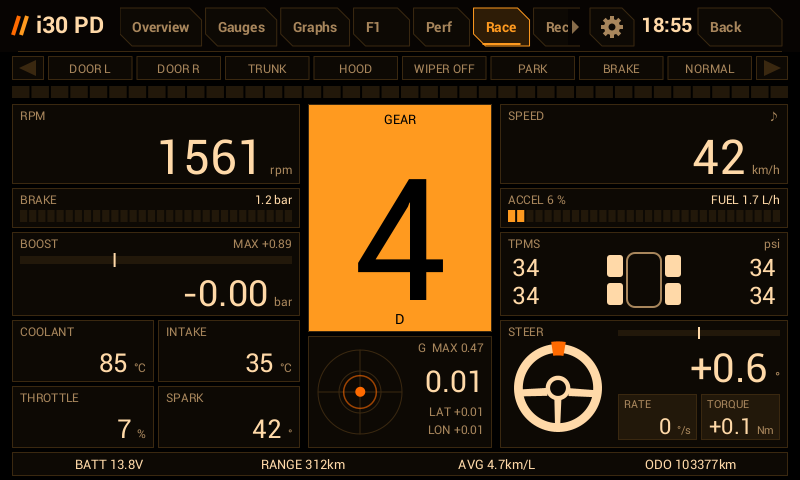 | 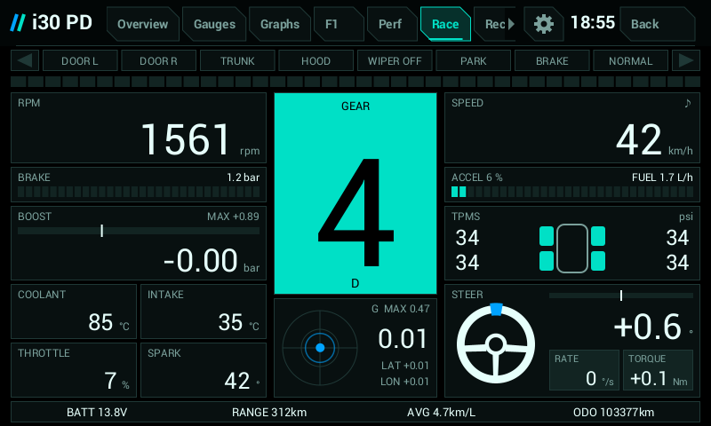 |

| 나이트 | 나이트 · 클래식 | |
|---|---|---|
| 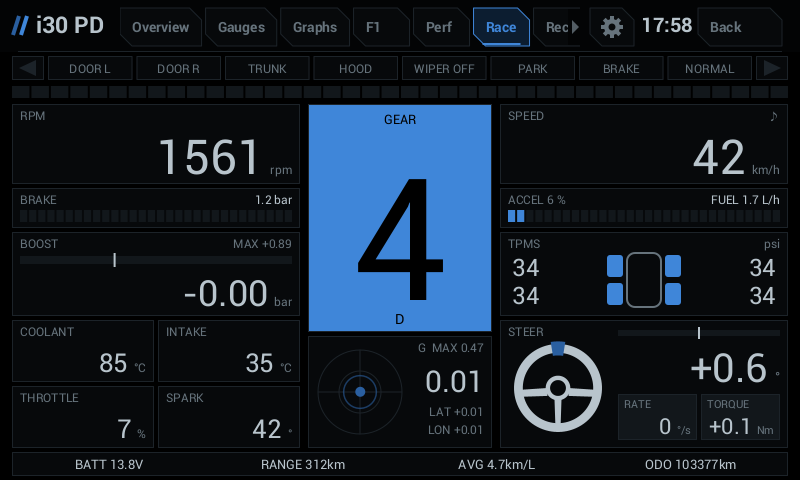 | 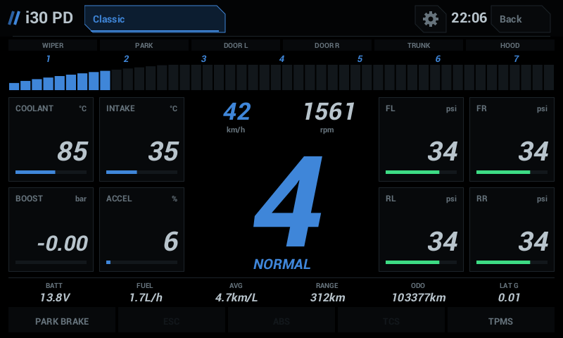 | |

| 로즈 | 코퍼 | 레드 |
|---|---|---|
|  |  |  |

| 그린 | | |
|---|---|---|
|  | | |

## 고장코드 조회 (테스트 버전, 2026-11-01, 실차 보류)

톱니바퀴 설정의 `진단` → `고장코드 읽기`를 누르면 창이 열리며 바로 읽는다. 대상은 엔진(EMS)·변속기(TCU)·제동(ABS/ESC)·조향(MDPS)·에어백(ACU)·바디(BCM). 순정 텔레매틱스 진단(DiagManager)과 같은 경로로 묻는다: `com.hkmc.micom.hscanmicomservice`의 `sendPacket(C7,40,80,40,80|ECU, 19 02 마스크)`(파워트레인 `0D`, 그 밖 `0C`), 거부되면 KWP `18 00 FF 00`. 응답은 1.75초 기다리고, `7F xx 78`(처리 중)이면 6초 더 기다린다. **읽기만** 한다(삭제 `14`·세션 `10`·보안 `27` 안 보냄).

- 제어기별로 코드(`P0301` 등), 상태(현재 고장 / 확정 / 대기(1회 감지) / 경고등 요청, 아무것도 아니면 과거 기록), 설명, 고장 유형(FTB, 예: 단선·접지 단락)을 보여 준다. 경고등·현재 고장 코드는 빨간색으로 맨 위에 온다. 에어백은 순정 코드에서 상태 비트 뜻이 반대라 상태를 표시하지 않는다.
- 설명: 이 차에서 나올 만한 표준(SAE J2012) 코드 약 240개를 한국어로 넣었다. 표에 없는 코드는 코드 자리로 분야를 알려 준다(예: "엔진 · 점화 계통 / 실화 (현대 전용 코드, 상세 설명 없음)"). 현대 전용 코드 설명은 공개 자료가 없어 차주가 실제로 본 코드를 받아 한 줄씩 더한다.
- 응답 없는 제어기는 "응답 없음 (미장착일 수 있음)"(예: 수동차의 변속기), 하나도 응답이 없으면 시동을 켜고 다시 조회하라고 안내한다. `다시 조회` 버튼으로 다시 읽는다.
- 영어 설정에서도 코드 설명과 상태 문구는 한국어로 나온다.

## 이번 패치로 채운 칸 / 남은 "—"

| 칸 (탭) | 소스 | 상태 |
|---|---|---|
| 냉각수 (조망·F1·퍼포먼스·레이스·게이지·그래프) | 0x09 EMS12 b1 ×0.75−48 | ✅ 위 이미지 84.8°C |
| 가속 페달 (조망·F1·레이스·게이지) | 0x09 EMS12 b6 ×0.3906 % 페달 | ✅ 5.9% |
| 부스트 (조망·레이스·게이지) | 0x0e EMS19 − 0x0a 대기압 | ✅ 정속 −0.00, 주행 최고 +0.89 bar |
| 점화시기 (레이스·게이지) | 0x0c EMS16 `SPK_TIME_CUR` | ✅ |
| 유온 | 오일온 센서가 없다. F1·퍼포먼스 탭과 게이지 기본 배치는 그 자리에 **흡기 온도**(0x0b EMS15)를 쓴다. 게이지·그래프 선택 목록의 "유온 (냉각수 대체)"는 헤드 냉각수 센서(0x09 EMS12 `TEMP_ENG`) 값 | ✅ 흡기/대체 |
| 미션유온 · SOC | 소스 없음 (EMS19 오일온 바이트 항상 0, TCU 온도 바이트 비어 있음) | — |
| 외기온 · 출력/토크(계산) · TCS/ESC/ABS | 미확정 | — |

화면의 차종 문구도 상단 `N / PIT` → `i30 PD`, F1 `i 3 0  P D`, F1+음악 `HYUNDAI i30`. 앱 이름 `N Dashboard`는 그대로.
