# 대시보드 앱 탭별 기능 (i30 PD 빌드)

이미지는 **실제 앱 렌더러 코드**(이 레포의 소스)에 **실차 주행 로그**(`logs/act_one_drive_10min_20261029_183922.log` 끝 지점, 42 km/h·4단)를 앱 자체 디코더 `Telemetry.hscanPd()`로 흘려 그린 것이다. 가짜 값 없음. 미리보기는 영어(EN) 화면으로 그렸다.

예전의 **대칭** 탭(esp32CarInfo 배치, `cluster/`)은 10/30에 앱에서 삭제했다. 같은 정보는 레이스 탭이 더 많이 보여 준다.

다시 그리기: `bash i30pd_port/app/preview/preview.sh <이 레포 루트> [로그] [출력 폴더] [로그 위치 0~1]` → `app/screens/*.png` (JDK만 필요, `android.graphics`는 Java2D 대역).

글꼴: 차량과 같은 Android 4.2 Roboto를 `preview/fonts/`(git 미포함, Apache 2.0)에 두면 영문·숫자를 Roboto로, 한글은 맑은 고딕으로 그린다(차량도 한글은 대체 글꼴). 없으면 전부 맑은 고딕. 받기:
```
for f in Roboto-Regular Roboto-Bold; do curl -sfL "https://android.googlesource.com/platform/frameworks/base/+/refs/heads/jb-mr1-release/data/fonts/$f.ttf?format=TEXT" | base64 -d > i30pd_port/app/preview/fonts/$f.ttf; done
```

## 공통 — 상단 내비 (52 px)

**화면 탭**(사용하는 화면마다 하나, 넘치면 옆으로 넘김), 시계 왼쪽 **톱니바퀴**(설정: 화면 사용 여부·테마·차량 색·주행 모드·언어·고장코드 조회), 시계, `돌아가기`(앱 종료). 화면 23개(전체 조망·게이지·그래프·F1·퍼포먼스·레이스·기록·쇼·클러스터 레이아웃 15개)는 모두 이 탭 줄과 화면 목록에 있다(테스트 버전부터, 아래 "화면 목록"). 곡이 바뀌면 하단에 미디어 알림 카드가 5초 뜬다(그래프 제외, 그리고 곡 정보를 이미 보여 주는 화면 — 레이스 탭 음악 칸·F1 음악·택시 라디오·카세트 — 에서는 뜨지 않음). 차량 값이 없으면 지어내지 않고 "—".

대시보드를 열면 1.5초 동안 **환영 화면**이 지나간다: 어두운 덮개가 걷히고, 강조색 띠가 화면을 가로지르고, `// i30 PD` 배지가 떠올랐다가 실시간 화면으로 바뀐다(아래는 중간 지점).

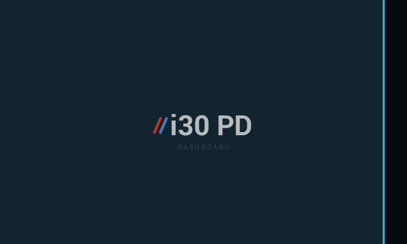

## 1. 전체 조망

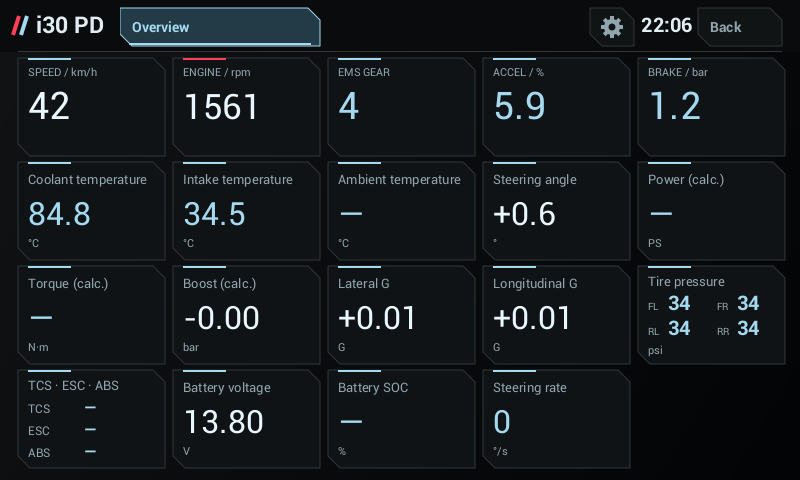

- 19칸 고정 배치. 첫 줄은 큰 헤드라인: **속도 · RPM · 현재 기어 · 가속 페달 · 브레이크압**.
- 나머지: 냉각수 · 흡기온 · 외기온 · 조향각 · 출력 / 토크 · 부스트 · 횡G · 종G · 타이어 공기압 4개 묶음 / TCS/ESC/ABS 묶음 · 배터리 전압 · SOC · 조향 속도. 오일온 센서가 없어 냉각수 값을 되풀이하던 유온 카드는 뺐다.
- 큰 숫자는 자리마다 같은 폭으로 그려서 `1`이 끼어도 숫자가 흔들리지 않는다(게이지·F1·레이스 탭도 같음).
- **카드를 탭하면 표시 모양이 순환**: 숫자 → 막대 → 원호 → 숫자. 값이 바뀌는 순간 숫자가 밝게 깜빡인다.

## 2. F1 (레이스 표시)

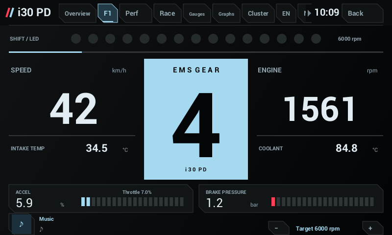

- **변속 LED 15개**(파랑 5 · 흰 5 · 빨강 5): 목표 RPM − 1500부터 100 rpm마다 하나씩 켜진다. 목표 이상 + 주행 중 + 1~5단이면 전체가 깜빡이며 `SHIFT ↑`.
- **목표 RPM은 하단 −/+로 3000~6700 조절**(디젤 2100~4700, 100 단위, 저장됨). 표시용 안내일 뿐 ECU 제어 아님.
- 가운데 큰 **현재 기어**, 좌 속도 · 우 RPM, 흡기온 · 냉각수, 스로틀 · 브레이크압 20칸 막대. 맨 위 가로선은 RPM 막대(0~8000).
- 좌하단 앨범 아이콘을 탭하면 → **F1 + 음악**:

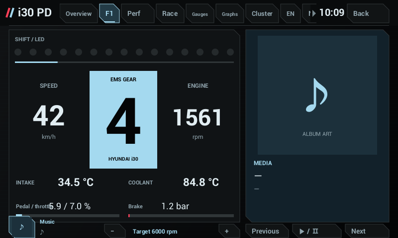

  왼쪽에 축소한 F1(LED·기어·속도·RPM·온도·페달), 오른쪽에 앨범 아트 · 곡 · 아티스트 · 진행 막대 · `이전 / 재생·일시정지 / 다음`.

## 3-1. 퍼포먼스 (N 차량 N 모드 '퍼포먼스' 화면 이식)

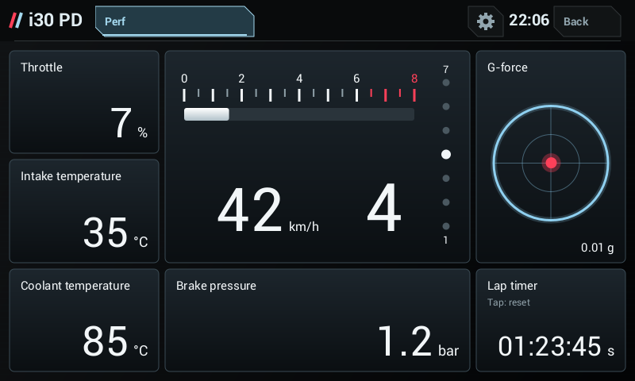

벨로스터 N·i30 N 순정 내비 N 모드의 퍼포먼스 화면 배치를 따랐다. 짙은 유리 카드(위가 밝은 그라데이션 + 얇은 테두리), 왼쪽 위 이름, 오른쪽 아래 큰 숫자와 작은 단위(글꼴은 전체 조망 탭과 같은 기본 글꼴).

- 왼쪽 3칸: **스로틀**(스로틀판 개도 TPS) · **흡기 온도** · **냉각수 온도**. N 화면의 오일 온도 자리에 흡기 온도를 넣었다(오일온 센서 없음).
- 가운데 큰 칸: **RPM 눈금**(0~8, 7000부터 빨강)과 흰 막대, 오른쪽 **단수 점 7개**(7DCT, 위가 7단), 아래 **속도 km/h**와 **변속 표시**(P/R/N, D에서는 단수, 수동 게이트에서는 `M3` 식).
- 가운데 아래: **브레이크 압력**(bar).
- 오른쪽 위: N 화면의 '서킷'(GPS 랩 지도) 자리. 이 앱은 GPS 트랙을 쓰지 않으므로 같은 모양(하늘색 원 + 빨간 점)의 **G-포스**(반경 1.2 g)를 넣었다.
- 오른쪽 아래: **랩 타이머** `분:초:1/100초`. 칸을 누를 때마다 시작 → 정지 → 초기화. 앱을 닫으면 사라진다. 미리보기 이미지의 01:23:45는 예시 값.

## 3-1b. 쇼

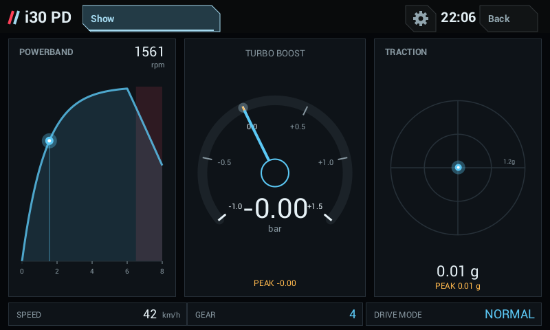

보는 재미를 위한 화면(화면 목록의 `쇼` 칸; 예전엔 퍼포먼스 탭을 한 번 더 눌렀다). 차가 이미 보내는 값만 쓴다.

- 왼쪽 **파워밴드**: 1.6 T-GDI 토크 곡선 모양(실측이 아닌 그림) 위를 현재 RPM 점이 따라 움직이고, 레드라인 구간을 표시한다.
- 가운데 **터보 부스트 게이지**(−1.0~+1.5 bar): 부드럽게 움직이는 바늘, 주황 최고값 바늘(`PEAK`), 부스트가 오를수록 커지는 빛.
- 오른쪽 **트랙션 서클**: 횡G·종G 점과 사라지는 잔상, 최고 g 표시.
- 아래 줄: 속도 · 기어 · 주행 모드. 강조 색이 주행 모드를 따른다(SPORT 빨강, ECO 초록, 그 외 하늘색).
- **가장자리 빛**: 세게 밟아 감속하면 빨강, 부스트가 오르면 파랑, 방향지시등을 켜면 그쪽 가장자리가 주황으로 깜빡인다. 아무 일도 없으면 꺼져 있다.

## 3-2. 레이스 (평면 레이싱 디스플레이)

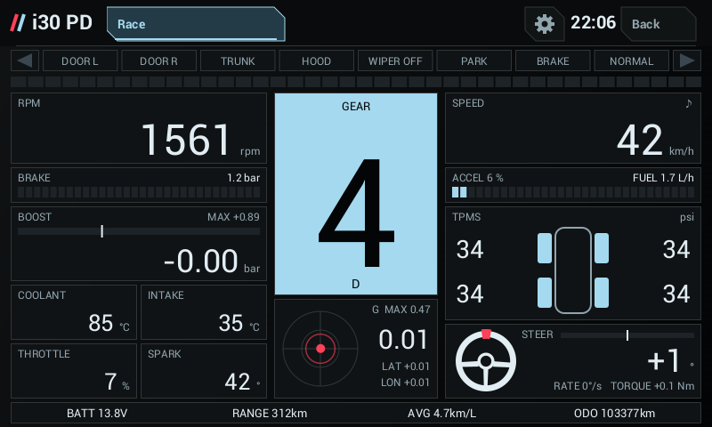

F1 탭처럼 평면 패널(직사각형, 1 px 테두리)과 F1 색으로, 애프터마켓 레이싱 디스플레이 배치를 따랐다. 한 화면에 최대한 많이.

레이스 탭과 기록 페이지는 한국어 설정에서도 글자를 영어로 쓴다.

- 맨 위 **상태 줄**: `DOOR L` · `DOOR R` · `TRUNK` · `HOOD`(열리면 빨강) · `WIPER OFF/LOW/HIGH`(작동 시 하늘색) · `PARK`(EPB 체결 시 빨강) · `BRAKE`(스위치 ON 시 주황) · 주행 모드(SPORT 빨강, ECO 초록). 값이 없으면 어두운 글씨. 줄 양 끝의 **방향지시등 화살표**는 깜빡이를 켜면 램프와 함께 주황으로 깜빡인다(CGW1 `TurnSigLh/Rh`, 꺼져 있으면 회색).
- 그 아래 **변속 등**: F1 탭의 변속 목표(기본 6000 rpm, F1 탭 `− / +`로 3000~6700, 디젤 기본 4200·2100~4700)를 쓴다. 목표의 마지막 1/4 구간(6000이면 1500 rpm 앞)부터 양 끝에서 가운데로 초록 → 주황 → 빨강이 차오르고, 목표에 닿으면 막대 전체가 하늘색으로 깜빡인다(0.1초 간격).
- **변속 연출**: 목표 300 rpm 앞부터 기어 칸에 빨간 테두리가 두꺼워지고, 목표에 닿으면 기어 칸이 빨강/하늘색으로 깜빡이며 `SHIFT ▲`, 화면 가장자리도 빨간 테두리로 함께 깜빡인다. 단수가 바뀐 직후(올릴 때·내릴 때 모두) 0.15초 동안 기어 칸이 하얗게 번쩍였다 돌아오고 숫자가 살짝 커졌다 줄어든다. 이 탭은 깜빡임을 위해 초당 20번 다시 그린다. 변속 신호는 1~6단에서만(7DCT 7단은 최고단).
- 왼쪽: **RPM**(6500 이상 빨강) · 그 아래 별도 칸 **브레이크 압력 막대**(빨강, 0~100 bar, F1 탭과 같은 눈금, 오른쪽에서 왼쪽으로 차오름 — 가운데 기어 칸을 사이에 두고 악셀 막대와 대칭) · **부스트**(−0.8~+1.5 bar 막대, 화면을 연 뒤의 최고값 `MAX`) · 작은 칸 4개 **COOLANT · INTAKE · THROTTLE · SPARK**(냉각수 · 흡기온 · 스로틀 · 점화시기. 냉각수 100/110°C, 흡기 60/80°C 경고 색).
- 가운데: **기어**(하늘색 칸, P/R/N, D에서는 단수, 수동 게이트에서는 `M3`, 아래에 변속 레버 위치) · **G**(합성 g 값, 횡 LAT · 종 LON, 작은 G-볼).
- 오른쪽: **속도** · 그 아래 별도 칸 **가속 페달 막대**(하늘색, 0~100 %, 같은 칸 오른쪽에 글자로 **순간 연료소모 L/h**) · **TPMS 그리드**(차체 윤곽 주위 네 바퀴, 30 psi 미만 주황, 26 psi 미만 빨강. 레이싱 디스플레이의 타이어 온도는 이 차 데이터에 없어 넣지 않았다) · **조향 칸**(조향각만큼 도는 단색 핸들 아이콘(N 핸들 배치: 조금 아래로 붙은 좌우 스포크와 아래 스포크 하나)과 큰 12시 방향 빨간 표시, ±540° 가운데 0 막대(반 바퀴를 넘으면 그림만으로는 방향을 알기 어려워서), 조향각, 조향 속도 °/s, 운전자 조향 토크 Nm).
- 맨 아래 **주행 줄**: 배터리 전압(12 V 미만 주황) · 주행가능거리 · 평균 연비 · 적산거리. 가속 측정이 진행 중이면 그 자리에 `0→100 km/h 3.4 s 측정 중`(주황), 끝나면 8초 동안 결과와 BEST(신기록이면 초록 ★)를 띄운다.
- **G**: 최근 약 2초의 궤적(옅은 하늘색 점)과 시동 후 최고 합성 G 경계선(빨간 원), `MAX` 값.
- **기어 칸 아래 안내**: 냉각수 70 °C 미만이면 `WARM-UP`, 부스트 0.5 bar 이상 또는 4500 rpm 이상을 쓴 뒤 2분 안에 정차하면 `COOL-DOWN 0:45`부터 거꾸로 센다(빨간 글씨). 변속 신호가 뜨면 `SHIFT ▲`가 우선.

막대로는 가속 페달을, 연료 분사량은 글자로만 보여 준다. 페달은 운전자가 직접 넣는 값이라 즉시 바뀌고 0~100 %로 막대에 맞는다. 연료 분사량은 페달·부하·회전수를 따라가는 결과값이라 막대를 하나 더 두면 같은 움직임이 겹친다.

## 3-3. 기록

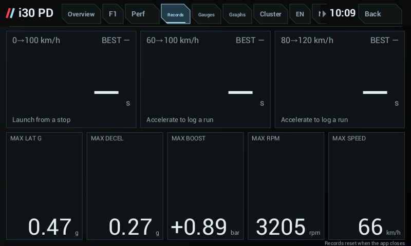

화면 목록의 `기록` 칸(예전엔 레이스 탭을 한 번 더 눌렀다). 계산은 `DriveStats`가 **어느 탭을 보고 있든** 매 화면마다 하고, 각 값의 수신 시각으로 재므로 화면 갱신 간격과 상관없다. 앱을 닫으면 초기화. 화면을 누를 필요가 없다.

- **가속 측정 3종**: `0→100 km/h`(정차 후 출발하면 자동 시작, 0.5 km/h를 넘는 순간), `60→100`, `80→120`(구간 아래 속도에서 가속해 들어가면 시작). 시작·끝 시각은 두 속도 샘플 사이를 선형으로 보간한다. 감속해 시작 속도 아래로 내려가거나 30초를 넘으면 취소. 최근 기록과 BEST.
- **최고 기록 5종**: 횡G(절댓값) · 감속G · 부스트 · RPM · 속도.

## 4. 게이지

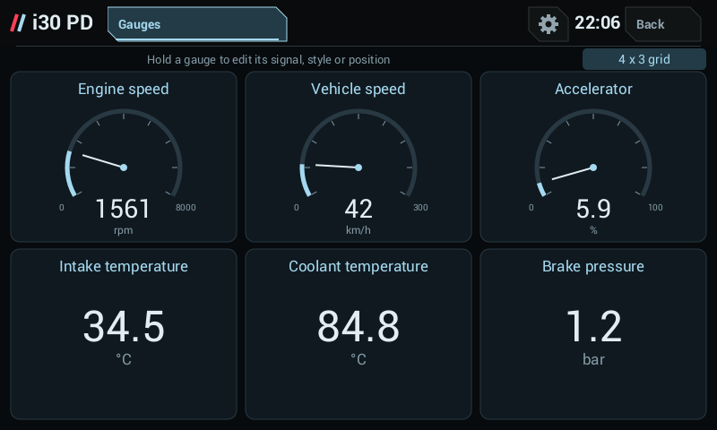
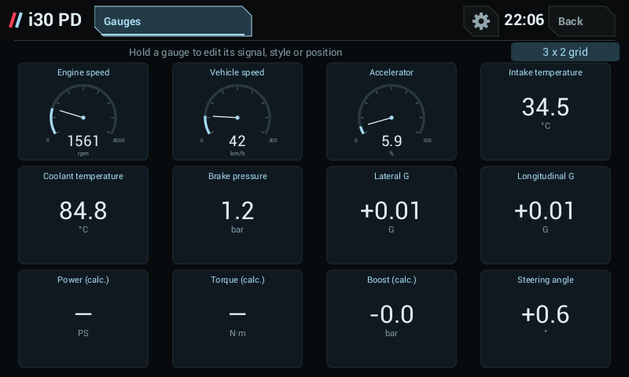

PD에서 새로 고를 수 있는 항목(순간 연료소모 · 평균 연비 · 주행가능거리 · 스로틀 개도 · 보정 토크 · 마찰 토크 · 점화 시기 · 브레이크 스위치 · 조향 토크 · 주행 모드 · 주차 브레이크 · 엔진 부하), 10/29 주행 로그 중간 지점 4×3:

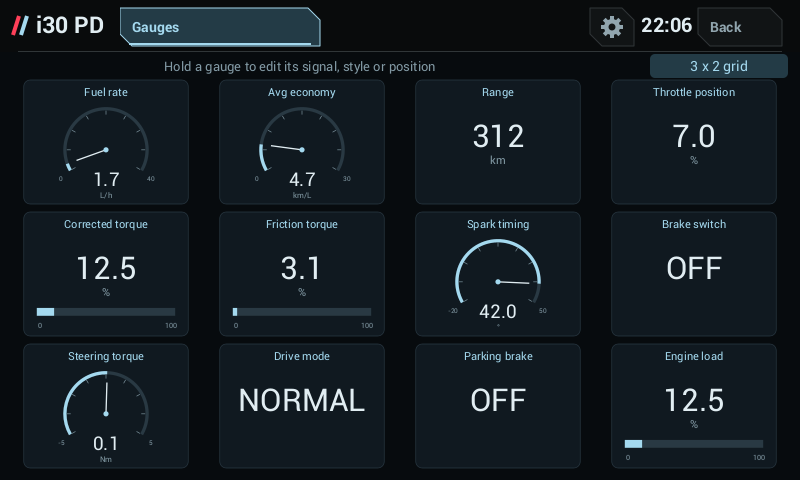

- 6칸(3×2) ↔ 12칸(4×3) 전환(우상단 버튼).
- **게이지를 길게(0.6초) 누르면 편집**: 항목(45개 신호 중 — 주행 모드·주차 브레이크는 글자로 표시) · 모양(원호 바늘 / 숫자+막대 / 큰 숫자) · 위치 교환. 저장됨.
- 기본 항목: RPM · 속도 · 스로틀 · 흡기온 · 냉각수 · 브레이크압 (+ 횡G · 종G · 출력 · 토크 · 부스트 · 조향각).

## 5. 그래프

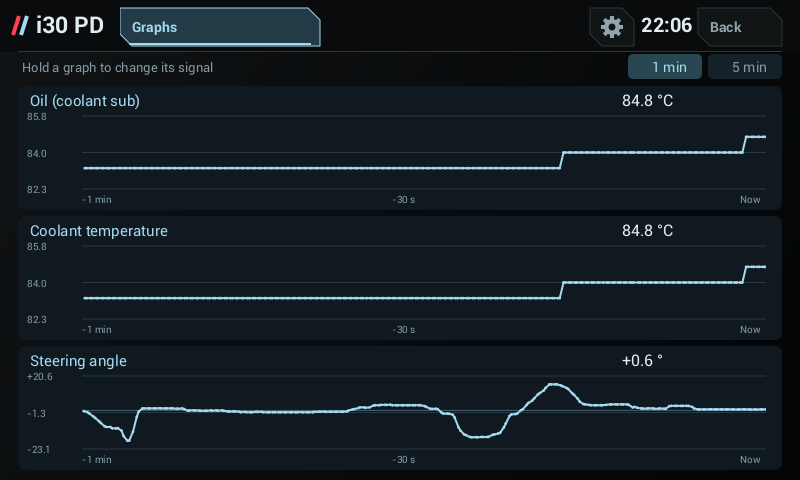
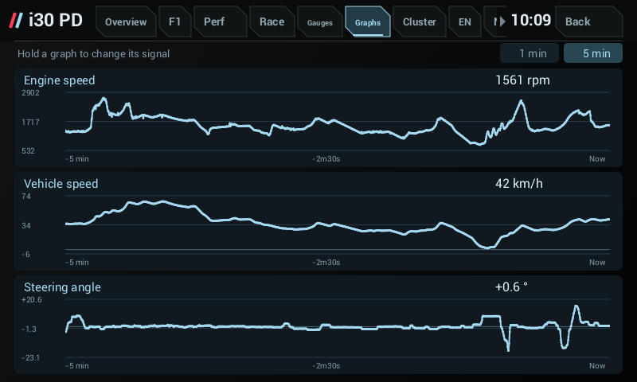

- 시계열 3줄, **1분 / 5분** 창 전환. 그래프를 길게 누르면 항목 변경(저장됨).
- 받은 값만 그린다 — 값이 끊긴 구간은 이어 붙이지 않는다(2초 넘게 비면 선을 끊음).
- 기본 항목은 오일온 · 냉각수 · 조향각인데, PD에선 앞의 둘이 아직 비어 있어 첫 화면은 빈 그래프가 된다(위 1번째). 아래는 RPM · 속도 · 조향각을 골라 5분 창으로 본 실제 주행 기록.

## 6. 클러스터 (새 탭, 2026-10-31, 프리뷰 검증·실차 보류)

벨로스터 N 자작 게이지 4세대(네이버 블로그 rio7377 「벨로스터N 4세대 게이지 사용기」)를 참고한 계기판 화면 3가지. 화면 탭을 누르면 다음 화면으로 넘어가고, 마지막에 본 화면을 기억한다. 단수가 바뀌면 기어 숫자가 0.15초 번쩍이며 1.2배에서 줄어든다. 위 상태 칸·아래 경고 칸은 **켜졌을 때만** 불이 들어오고, i30에 신호가 없는 항목(전조등, 엔진·변속기 경고, 타이어 온도, 오일 온도, ECS·LSD)은 넣지 않았다.

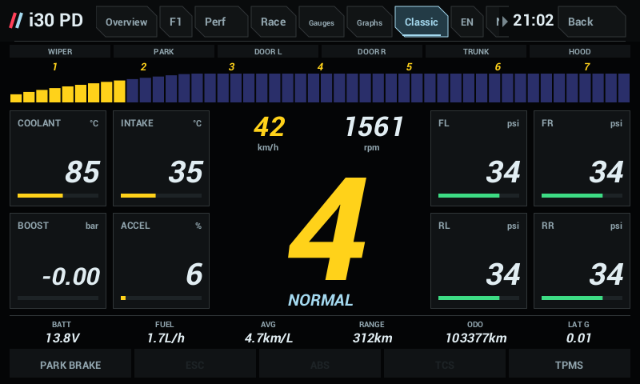

- **클래식**(좌우 대칭, 테마 강조색 사용 — N은 노랑): 와이퍼·주차·문·트렁크·후드 상태 칸, 계단형 회전 곡선(레드라인 넘으면 경고색) 위에 단수 숫자. 왼쪽 2×2 엔진 칸(냉각수·흡기·부스트·가속, 값 + 막대)과 오른쪽 2×2 타이어 칸(FL·FR·RL·RR psi, 막대 정상 초록 / 30 psi 미만 앰버 / 26 미만 경고색 + 테두리)이 같은 모양으로 마주 본다. 가운데 위 속도·RPM, 큰 이탤릭 기어, 아래 주행 모드(6MT는 옆에 변속 권장 `▲4`). 하단 라벨 6칸 BATT·FUEL(L/h)·AVG(km/L)·RANGE·ODO·LAT G, 경고 칸 PARK BRAKE·ESC·ABS·TCS·TPMS.

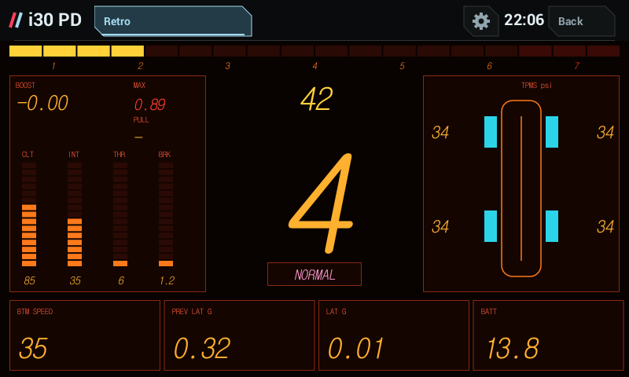

- **레트로**(사이버포뮬러 느낌, 테마와 상관없이 주황 LCD 색): 세그먼트 회전 막대, 부스트와 세션 최대(MAX)·직전 가속 최대(PULL), 냉각수·흡기·가속 페달·브레이크 압력 막대, 차 윗모습 위 공기압, 아래 **코너 최저 속도(BTM SPEED)·직전 코너 최대 횡G·현재 횡G**·전압.
  - 코너 = 횡G 0.25 g 이상이 1초 넘게 이어진 구간. 0.5초 동안 그 아래면 끝나고 그 구간의 최저 속도·최대 횡G를 굳힌다. 가속 = 가속 페달 70% 이상이 0.5초 넘게 이어진 구간, 0.3초 떼면 그 구간 최대 부스트를 굳힌다(툭 밟은 건 기록 안 함). 화면을 숨겨 1초 넘게 값이 비면 진행 중이던 코너·가속은 버린다. 문턱은 실차로 조정 예정.

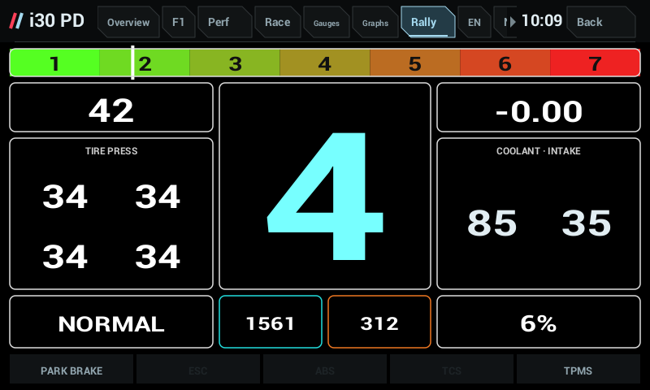

- **WRC 랠리**: 흰 둥근 칸에 옆으로 넓은 굵은 숫자만. 단수마다 초록→빨강 한 칸인 회전 막대(흰 선이 현재 RPM), 속도·부스트·공기압·냉각수/흡기·주행 모드·RPM·주행가능거리·가속.

### 클러스터 레이아웃 17개 (테스트 버전, 2026-11-01, 프리뷰 확인·실차 보류)

**화면 목록**: 머리의 화면 탭을 **짧게 누르면 다음 화면**, **0.6초 길게 누르면 목록**(6×5)이 뜨고 칸을 눌러 바로 고른다(바깥을 누르면 닫힘). 목록에는 25개 화면이 모두 들어 있다 — 전체 조망·게이지·그래프·F1·퍼포먼스·레이스·기록·쇼, 그리고 아래 레이아웃 17개. 예전처럼 퍼포먼스·레이스를 한 번 더 눌러 쇼·기록으로 가는 방식은 없어졌고, 쇼·기록도 목록의 한 칸이다.

- **설정**(시계 왼쪽 톱니바퀴): 왼쪽에 분류(`화면 · 테마 · 차량 색 · 주행 모드 · 언어 · 진단 · 완료`), 오른쪽에 고른 분류의 목록이 나온다. 누르는 즉시 적용·저장되고, `완료`나 톱니바퀴를 다시 누르면 닫힌다.
  - `화면`: 23개 화면마다 `사용`/`미사용`. 미사용 화면은 탭 줄·목록에 안 나오고 넘길 때도 건너뛴다. 마지막 남은 사용 화면은 끌 수 없고, 지금 보던 화면을 끄면 다음 사용 화면으로 넘어간다.
  - `테마`: 10개 테마를 색 견본과 함께 나열(아래 "테마"). `차량 색`: 8비트 두 화면의 차 색 9가지(아래).
  - `주행 모드`(둘 다 기본 끔): **모드 색** — ECO는 초록, SPORT는 주황빨강으로 모든 화면의 강조색이 바뀐다(경고 빨강과는 다른 색). **모드 화면** — 주행 모드를 바꾸면 그 모드의 화면으로 넘어간다. 아래 SPORT·ECO·NORMAL 줄을 누르면 화면 목록이 열려 모드마다 화면을 고른다(기본 SPORT→F1, ECO→에코, NORMAL→원래 화면). `원래 화면`은 처음 넘어가기 전에 보던 화면으로 돌아가는 것이고, 그 사이 직접 다른 화면으로 옮겼으면 그대로 둔다. 미사용 화면으로는 넘어가지 않는다.
  - `언어`: 시스템 / 한국어 / English. `진단`: 고장코드 조회 창(아래 "고장코드 조회").
- **저장**: 지금 화면(`cluster_screen`)과 미사용 목록(`cluster_hidden`, 비트 마스크)을 `pit_vehicle_ui` 설정에 저장해서 재부팅 뒤에도 유지된다. 대시보드는 마지막에 보던 화면으로 열린다(처음엔 전체 조망). 예전 `cluster_layout` 값은 쓰지 않는다.

| 설정 · 화면 | 설정 · 주행 모드 | 모드 화면 고르기 |
|---|---|---|
| 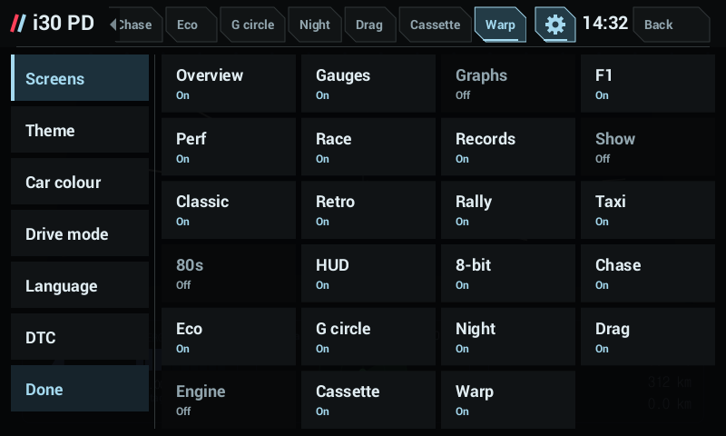 | 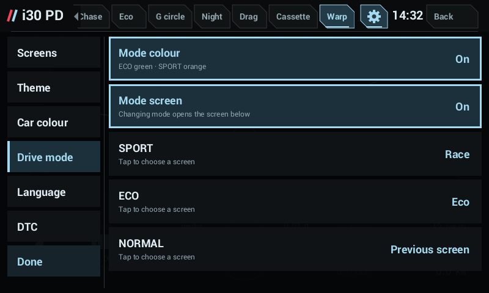 | 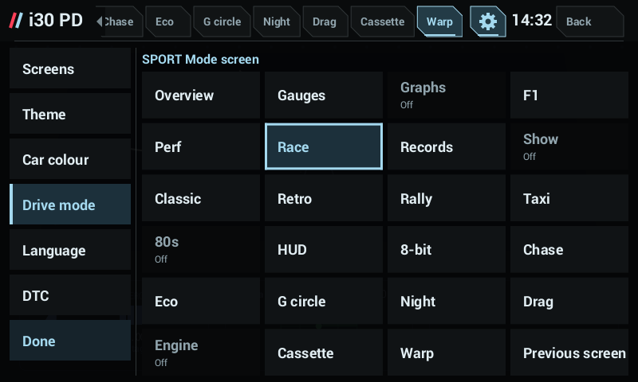 |

새 12개 레이아웃은 각자 색을 쓰고(에코·마찰원·드래그는 테마를 따름), 그래프와 꼬리는 텔레메트리 기록(250 ms, 5분)에서 그려 탭을 연 순간부터 채워져 있다. 그림자·빛 번짐은 쓰지 않는다(헤드유닛은 소프트웨어로 그림).

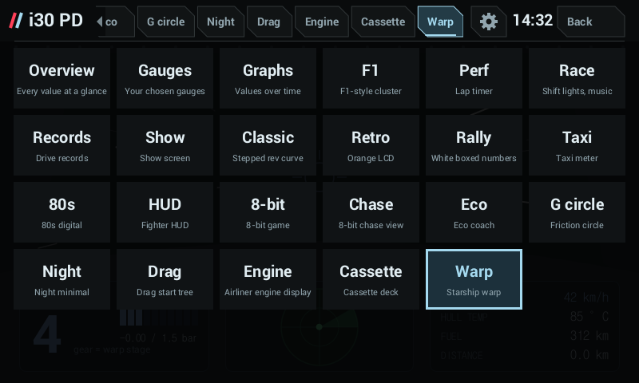

| 택시 미터기 | 80년대 디지털 | 전투기 HUD |
|---|---|---|
| 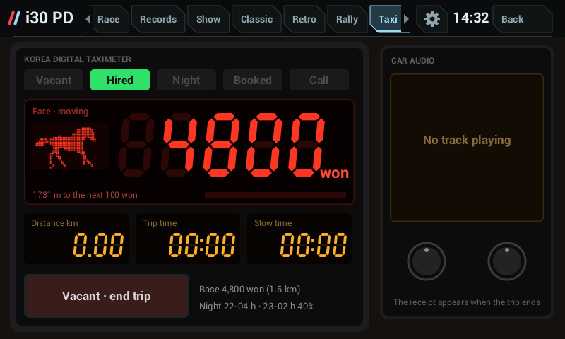 | 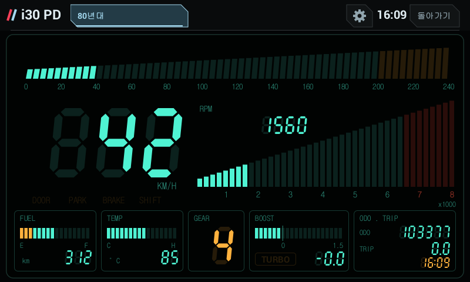 | 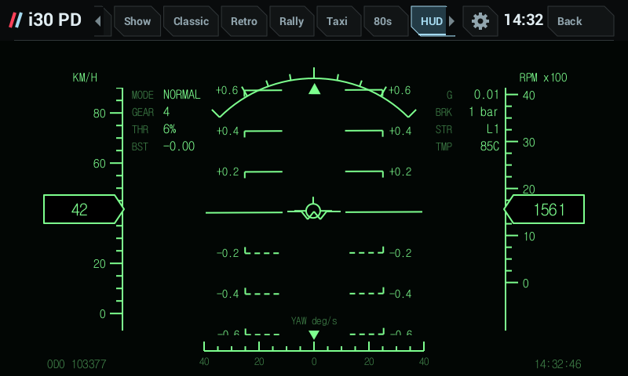 |
| **8비트 게임** | **8비트 추격 시점** | **에코 코치** |
| 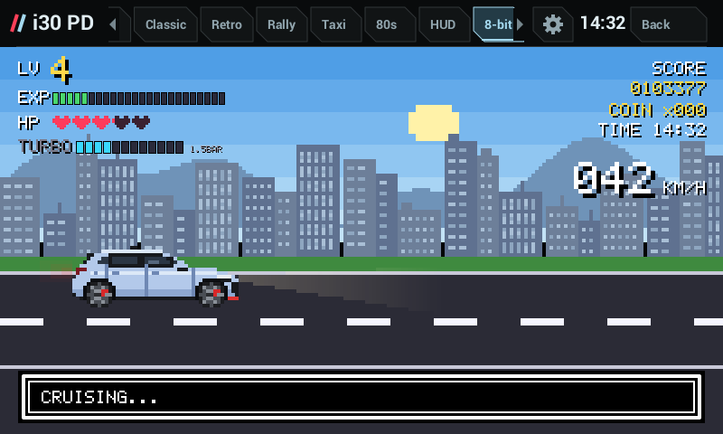 | 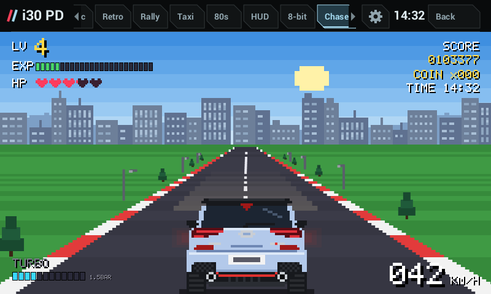 | 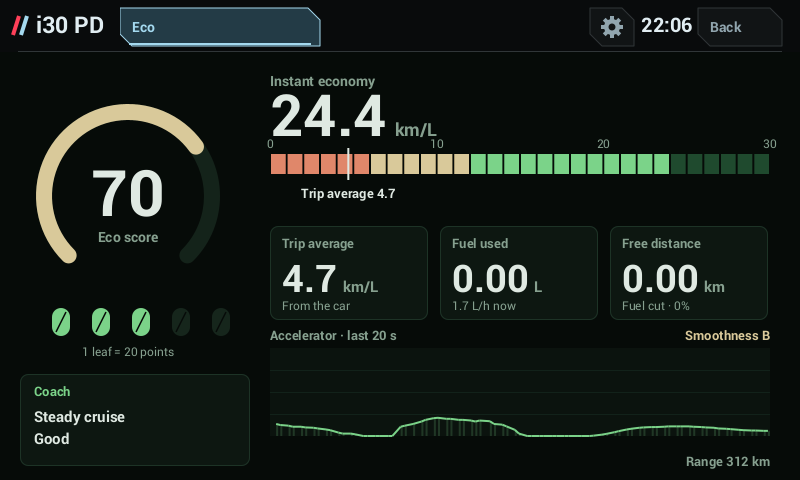 |
| **8비트 · 밤** | **추격 시점 · 밤** | **마찰원** |
| 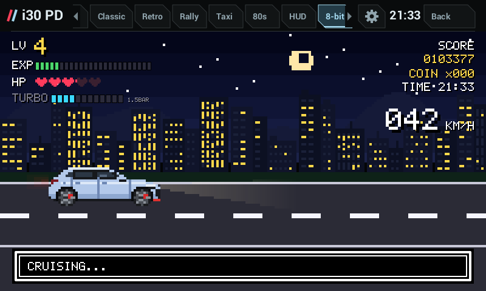 | 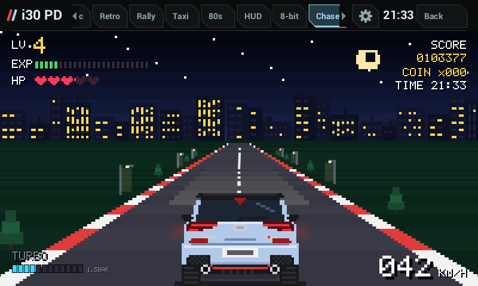 | 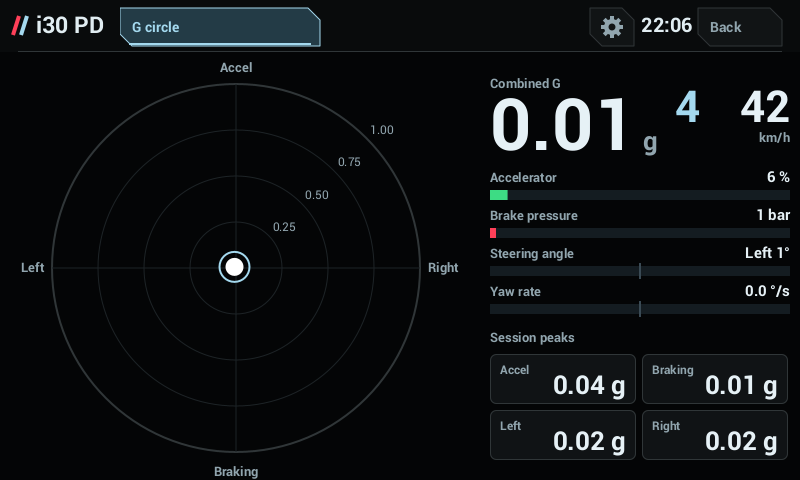 |
| **야간 미니멀** | **드래그 출발 트리** | **비행기 엔진 계기판** |
| 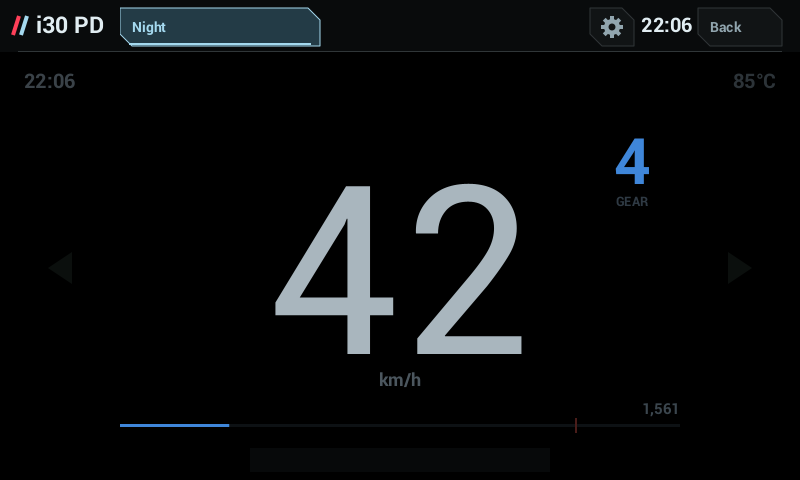 | 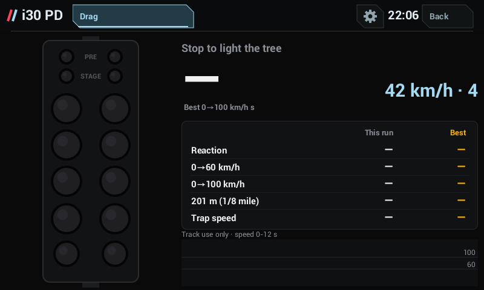 | 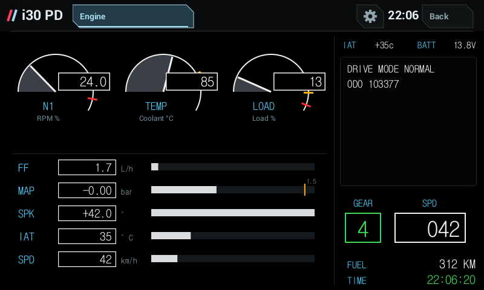 |
| **카세트 데크** | **우주선 워프** | |
| 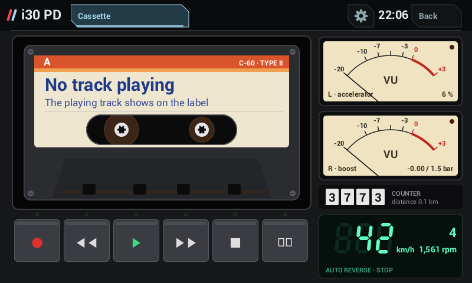 | 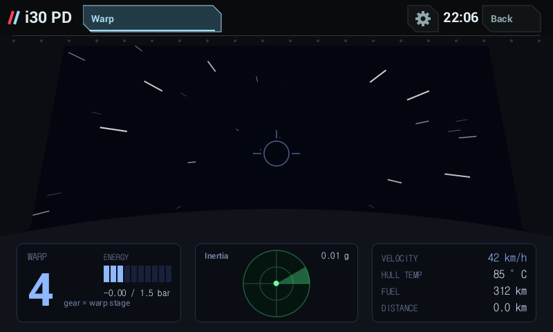 | |

- **택시 미터기**: 서울 중형 요금(서울시 교통 누리집, 2023-02-01 시행) — 기본 4,800원(1.6 km), 131 m마다 또는 15 km/h 이하 30초마다 100원(실제 미터기처럼 **거리·시간 병산**: 15 km/h 넘으면 거리만, 이하면 시간만 세고 기본 1.6 km도 둘을 합친 거리로 소진), 22~23·02~04시 20%, 23~02시 40%(그 시각에 올라간 100원 단위에만 붙어, 끝난 영수증은 시각이 바뀌어도 그대로), 100원 단위 반올림. 다른 화면을 보는 동안에도 요금·거리·시간이 계속 올라간다(VFD TRIP, 에코 연료, 워프 거리도 같음). 차가 움직이면 미터가 켜지고 `빈차 · 운행 종료`로 끝낸다. 요금판 옆 LED 창에서 실제 말 영상에서 한 보폭(10장면)을 따 온 말이 속도에 맞춰 달린다(100 km/h 이상이면 영상과 같은 0.4초 보폭). 오른쪽 칸은 평소엔 **카오디오**(재생 소스, 재생/일시정지, 곡 제목 두 줄, 가수, 진행 막대)이고, `빈차 · 운행 종료`를 누르면 그 운행의 **영수증**으로 바뀐다. 영수증을 누르면 다시 음악으로, 다음 운행이 시작돼도 음악으로 돌아간다. 달리는 중에 운행을 끝내면 한 번 멈춰 선(3 km/h 이하) 뒤에야 다음 운행이 시작돼 영수증이 바로 사라지지 않는다.

| 운행 중 (음악) | 운행 종료 (영수증) |
|---|---|
| 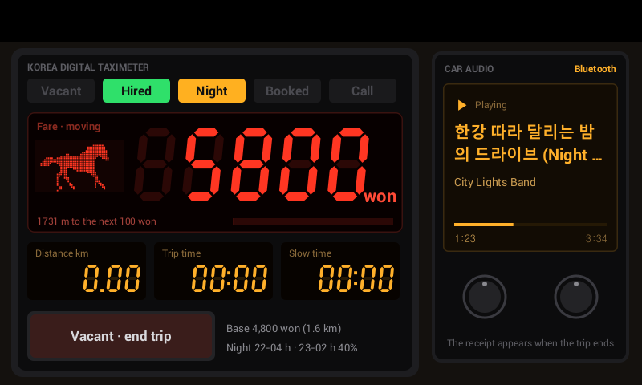 | 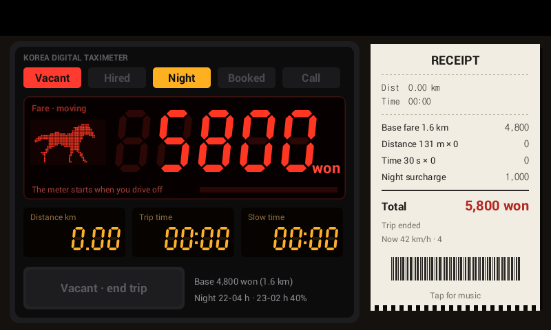 |

- **80년대 디지털**: 청록 VFD, 계단 속도 막대·오르막 RPM 막대, 0.4 bar 넘으면 TURBO 램프.
- **전투기 HUD**: 횡G로 기울고 종G로 오르내리는 사다리, G 방향 표시, 속도·RPM 테이프, 요레이트 눈금, 레드라인 500 rpm 전부터 SHIFT.
- **8비트 게임 / 8비트 추격 시점**: 도트 i30 N(PD). 차 색은 톱니바퀴 설정의 `차량 색`에서 고르며(기본 N의 퍼포먼스 블루, 그다음 국내 i30(PD) 출시 색: 폴라 화이트 → 파이어리 레드 → 팬텀 블랙 → 아이언 그레이 → 스타게이징 블루 → 데미타스 브라운, 2019년형에 추가된 인텐스 블루 → 라바 오렌지, 저장됨), 두 화면 모두에 같이 적용된다. 옆모습은 현대 공식 측면 사진을 46칸으로 축소한 윤곽, 뒷모습은 공식 정후면 사진(폭:높이 1.24)을 따라 그렸다(유리 위 큰 윙, 길게 이어진 테일램프 LED, 빨간 N 배지, 모서리까지 감싼 범퍼와 벌집 통풍구, 머플러 사이 곧은 빨간 디퓨저 줄). 추격 시점은 뒤에서 따라가는 3인칭이고 도로가 핸들 조향으로 휜다. LV=단수, EXP=RPM, 하트=주행가능거리 100 km, SCORE=주행거리, 연료 차단 1초=코인. 글자는 모두 5×7 도트 글꼴(코드에 넣은 글자, 문자열마다 그림자까지 한 번 그려 두고 한 번에 찍음, 최근 64개 보관). 상향등은 하향등 위로 수평으로 멀리 은은하게 뻗는다(추격 시점은 먼 노면까지 밝아짐). 주행 모드: 바뀌면 대화창에 1.5초 안내, 평소 대사도 모드별(`CRUISING...` / `ECO RUN...` / `BATTLE MODE...`). ECO는 연료 차단 코인 2배와 뒷바퀴에서 날리는 나뭇잎 몇 장, SPORT는 차체 1칸 낮춤과 옅은 속도선(추격 시점은 소실점에서 퍼짐). 모든 모드에서 3000 rpm 넘게 밟다가(40 %+) 0.7초 안에 떼면 배기구에 백파이어가 0.45초.
  - **하늘**은 시계(서울 월별 일출·일몰, 앞뒤 30분은 노을)로 낮·노을·밤을 바꾸고(`DayPhase`, 테스트), 가로등과 중간층 도시 스카이라인의 창 불빛(건물마다 다른 비율·창 모양, 해시로 흩뿌림)도 하늘을 따른다. 맨 뒤는 산.
  - **차 조명은 차 신호 그대로**, 낮에도: 전조등·미등은 새 신호 53 `HEAD_LAMP`(CGW1 `HeadLampLow`, 슬롯 `0x01` byte3 bit7), 제동등은 브레이크 압력, 깜빡이는 신호 비트(실제 램프와 같이 점멸)로 차 램프에서만 보인다(옆모습은 보이는 왼쪽만).
- **에코 코치**: 순간 연비와 트립 평균(차 계산값), 사용 연료, 연료 차단으로 달린 "공짜 주행", 최근 20초 페달과 부드러움 점수(가늠용 공식).
- **마찰원**: 최근 4초 G 꼬리, 방향별 세션 최대, 페달·브레이크·조향·요레이트 막대.
- **야간 미니멀**: 큰 속도 하나와 얇은 RPM 선. 문·트렁크·후드 열림, 공기압 30 psi 미만, 냉각수 110°C, 주행 중 주차 브레이크일 때만 아래 칸이 켜진다.
- **드래그 출발 트리**(트랙 전용): 1.5초 정차하면 노랑 3개 → 초록. 초록 전에 출발하면 빨강. 반응·0→60·0→100·201 m·통과 속도, 세션 최고.
- **비행기 엔진 계기판**: N1(레드라인 대비 RPM %)·냉각수·부하 다이얼, FF·MAP·SPK·IAT·SPD 막대, 색 메시지 창, 초록 GEAR 칸.
- **카세트 데크**: 재생 중인 곡이 라벨에, 곡 진행만큼 테이프가 감김. 릴은 RPM, VU는 페달·부스트.
- **우주선 워프**: 별 160개가 속도만큼 날아옴(부스트면 푸른빛), 워프 단계=단수, 에너지=부스트, 관성 레이더=G, 급제동 빨간 경보.
- **오실로스코프**: XY = 횡G·종G 3초 잔상, 위쪽 RPM 5초, 주파수 계수기 = RPM ÷ 60.
- **점화·노킹 모니터**: 노킹 센서 값은 버스에 없다. 풀부하(페달 70% 초과, 부스트 0.3 bar 초과)에서 점화가 우리 차 로그의 풀부하 선(약 13 − 9 × 부스트 °)보다 늦으면 그만큼을 "지각 추정"으로 표시(`SparkRetard`, 테스트 포함). 튜닝 차는 이 선에서 벗어날 수 있다.
- **그리기 비용**: 한 장당 그리기 명령 수(헤더 제외, PC에서 셈) — 야간 15 · G 원·랠리 51 · 엔진 73 · 에코·드래그 83 · 노킹 98 · 레트로 136 · 클래식 145 · 8비트 147 · HUD 149 · 카세트 166 · 워프 227 · 오실로 234 · 택시 316 · 80년대 409 · 추격 428. 8비트 두 화면의 차(조명 상태별)·도시·산·하트·전조등 빛과 택시의 말은 처음 한 번 작은 비트맵에 그려 두고 찍는다(처음엔 8비트 1,940·추격 1,330·택시 613). 실차 시간은 logcat `VehicleDash` 5초 줄 끝의 `draw avg … max … ms`로 본다(하드웨어 가속이면 기록 시간).
- **부스트 막대 범위**: 모든 탭(클래식·레이스·쇼·새 레이아웃)이 1.5 bar까지 그리고, 이번 주행에서 그보다 높은 부스트가 나오면 0.5 bar씩 늘린다(`DriveStats.boostTop`).

## 테마 (2026-10-31, 프리뷰 검증·실차 보류)

톱니바퀴 설정의 `테마`에서 **N · 람보(LB) · BMW(M) · 아이스(IC) · 모노(MO) · 앰버(AM) · 틸(EV) · 나이트(NT) · 로즈(RS) · 코퍼(CU)** 중 하나를 누르면 모든 탭 색이 바뀌고, 고른 테마는 저장된다. N은 지금까지와 같은 화면(헤더 아래는 픽셀 단위로 동일, `preview/BodyDiff.java`로 비교). 람보는 칸 네 모서리를 깎고 숫자를 굵게, BMW는 칸을 둥글게 하고 헤더 위에 M 삼색 띠. 로즈는 BMW처럼 둥근 칸(띠 없음), 코퍼는 람보처럼 육각 칸(숫자 굵기는 보통). 쇼 탭의 주행 모드별 강조색은 N에서만. 경고(과열·공기압·문/트렁크/후드 열림·주차 브레이크·ESC/ABS/TCS)는 테마와 무관한 경고색이고, 앰버에선 흰 테두리를 더해 강조색과 구분한다.

아이스·모노·앰버·틸·나이트는 차량 계기판 색을 따온 테마다. 이들과 로즈(분홍)·코퍼(구리색)는 배경이 완전 검정(#000000)이라 밤에 화면이 덜 번진다. 레이스 탭 평균 밝기(0~255): N 44.7 · 람보 42.5 · BMW 41.1 · 아이스 35.5 · 모노 40.8 · 앰버 33.6 · 틸 35.0 · 나이트 26.1(글자까지 어둡게 한 야간용) · 로즈 37.5 · 코퍼 33.6.

| 람보 | BMW | 아이스 |
|---|---|---|
| 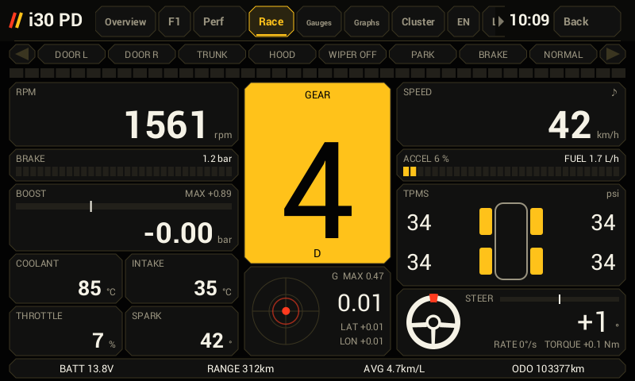 | 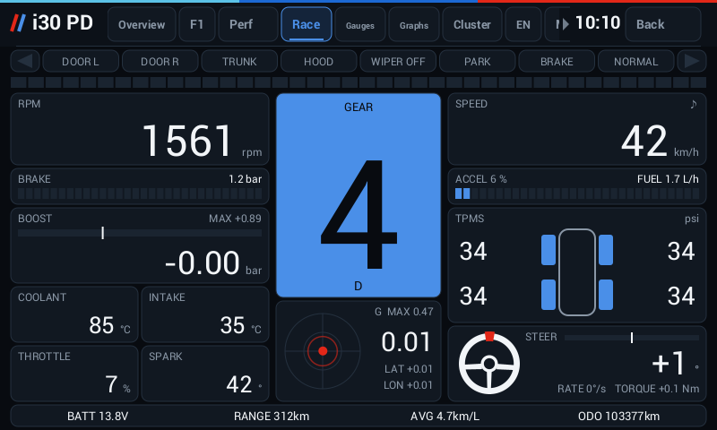 | 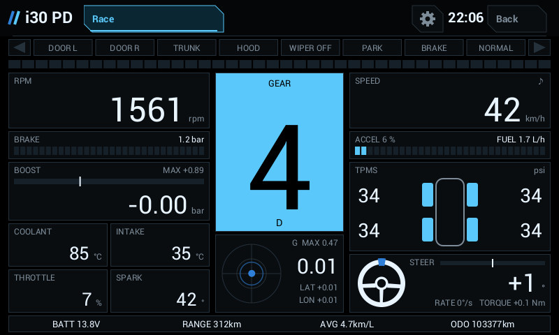 |

| 모노 | 앰버 | 틸 |
|---|---|---|
| 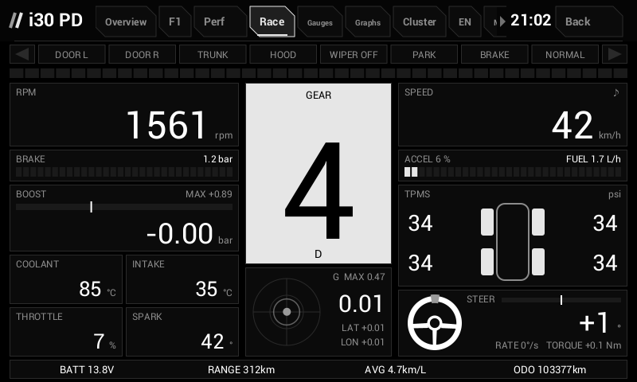 | 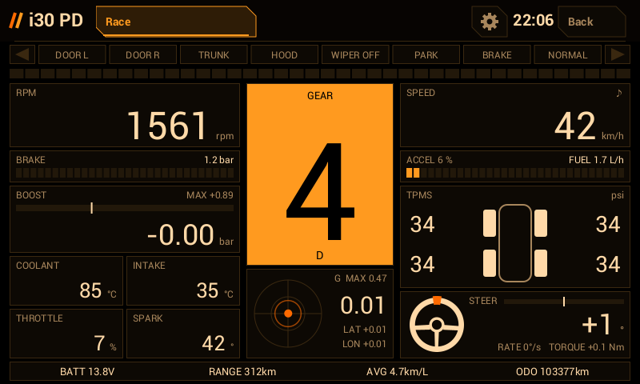 | 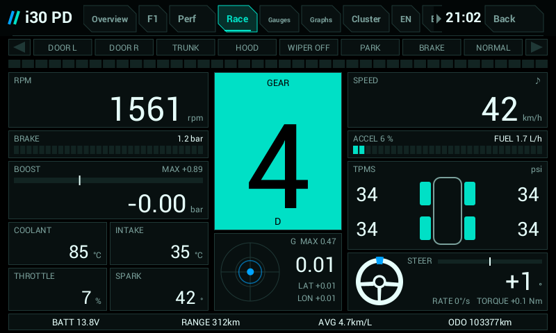 |

| 나이트 | 나이트 · 클래식 | |
|---|---|---|
|  | 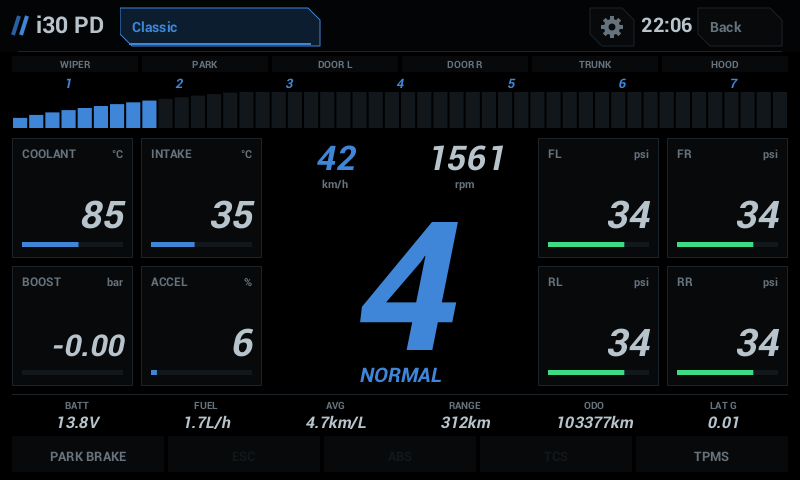 | |

| 로즈 | 코퍼 | |
|---|---|---|
| 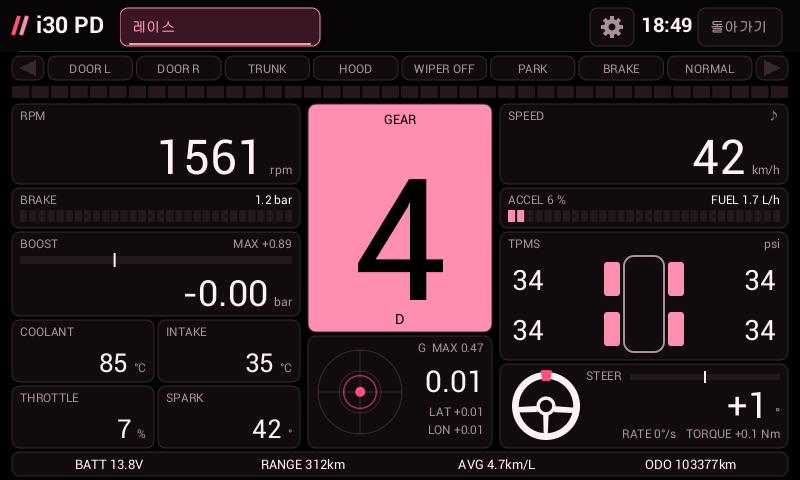 | 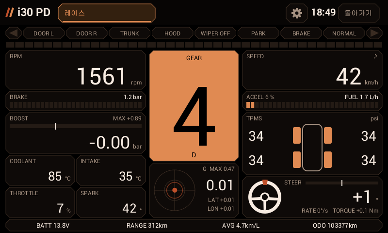 | |

## 고장코드 조회 (테스트 버전, 2026-11-01, 실차 보류)

톱니바퀴 설정의 `진단` → `고장코드 읽기`를 누르면 창이 열리며 바로 읽는다. 대상은 엔진(EMS)·변속기(TCU)·제동(ABS/ESC)·조향(MDPS)·에어백(ACU)·바디(BCM). 순정 텔레매틱스 진단(DiagManager)과 같은 경로로 묻는다: `com.hkmc.micom.hscanmicomservice`의 `sendPacket(C7,40,80,40,80|ECU, 19 02 마스크)`(파워트레인 `0D`, 그 밖 `0C`), 거부되면 KWP `18 00 FF 00`. 응답은 1.75초 기다리고, `7F xx 78`(처리 중)이면 6초 더 기다린다. **읽기만** 한다(삭제 `14`·세션 `10`·보안 `27` 안 보냄).

- 제어기별로 코드(`P0301` 등), 상태(현재 고장 / 확정 / 대기(1회 감지) / 경고등 요청, 아무것도 아니면 과거 기록), 설명, 고장 유형(FTB, 예: 단선·접지 단락)을 보여 준다. 경고등·현재 고장 코드는 빨간색으로 맨 위에 온다. 에어백은 순정 코드에서 상태 비트 뜻이 반대라 상태를 표시하지 않는다.
- 설명: 이 차에서 나올 만한 표준(SAE J2012) 코드 약 240개를 한국어로 넣었다. 표에 없는 코드는 코드 자리로 분야를 알려 준다(예: "엔진 · 점화 계통 / 실화 (현대 전용 코드, 상세 설명 없음)"). 현대 전용 코드 설명은 공개 자료가 없어 차주가 실제로 본 코드를 받아 한 줄씩 더한다.
- 응답 없는 제어기는 "응답 없음 (미장착일 수 있음)"(예: 수동차의 변속기), 하나도 응답이 없으면 시동을 켜고 다시 조회하라고 안내한다. `다시 조회` 버튼으로 다시 읽는다.
- 영어 설정에서도 코드 설명과 상태 문구는 한국어로 나온다.

## 이번 패치로 채운 칸 / 남은 "—"

| 칸 (탭) | 소스 | 상태 |
|---|---|---|
| 냉각수 (조망·F1·퍼포먼스·레이스·게이지·그래프) | 0x09 EMS12 b1 ×0.75−48 | ✅ 위 이미지 84.8°C |
| 가속 페달 (조망·F1·레이스·게이지) | 0x09 EMS12 b6 ×0.3906 % 페달 | ✅ 5.9% |
| 부스트 (조망·레이스·게이지) | 0x0e EMS19 − 0x0a 대기압 | ✅ 정속 −0.00, 주행 최고 +0.89 bar |
| 점화시기 (레이스·게이지) | 0x0c EMS16 `SPK_TIME_CUR` | ✅ |
| 유온 | 오일온 센서가 없다. F1·퍼포먼스 탭과 게이지 기본 배치는 그 자리에 **흡기 온도**(0x0b EMS15)를 쓴다. 게이지·그래프 선택 목록의 "유온 (냉각수 대체)"는 헤드 냉각수 센서(0x09 EMS12 `TEMP_ENG`) 값 | ✅ 흡기/대체 |
| 미션유온 · SOC | 소스 없음 (EMS19 오일온 바이트 항상 0, TCU 온도 바이트 비어 있음) | — |
| 외기온 · 출력/토크(계산) · TCS/ESC/ABS | 미확정 | — |

화면의 차종 문구도 상단 `N / PIT` → `i30 PD`, F1 `i 3 0  P D`, F1+음악 `HYUNDAI i30`. 앱 이름 `N Dashboard`는 그대로.
